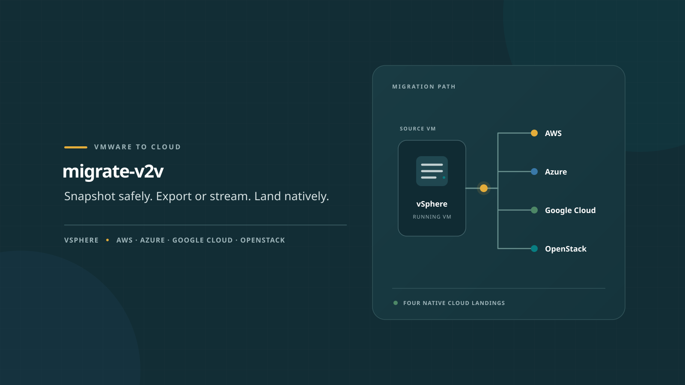

<!-- markdownlint-disable MD013 -->

Migrate a vSphere VM to AWS, Azure, OpenStack, or GCP. The standard migration
workflow uses a quiesced snapshot, a full clone, and an OVF/OVA export. Each
target imports the resulting disk artifacts using its native image workflow.
OpenStack and Azure also support a [datastore-direct workflow](doc/datastore-direct.md)
that streams snapshot disks without a clone or OVF/OVA export. Neither workflow
powers off the source VM, though the datastore-direct curl backend cannot read
a powered-on VM's disks on VMFS; use the recommended VDDK backend in that case.

The playbooks run directly on the control host using Ansible and `govc`, plus
`ovftool` for the standard export workflow.

Runtime artifacts, catalogs, encrypted vaults, and tools downloaded on demand
live under `/work/migrate-v2v/` by default. Set `MIGRATE_V2V_VAULT_DIR` or
`MIGRATE_V2V_CATALOG_DIR` to move vaults or catalogs independently. Dialogs
derive those directory defaults from `ARTIFACT_ROOT`; direct playbook runs
accept `-e artifact_root=` for migration run directories. See
[Artifact Root](#artifact-root).
Upgrading from a checkout that kept vaults and catalogs in the repository
needs a one-time move; see [Secrets](#secrets) and
[Migration Catalog](#migration-catalog).

## Flow

Choose a destination and a source disk method, then follow the same sequence:
prepare the control host, configure access, migrate the VM, launch it from the
recorded image, and reconcile catalogs if cloud resources are later removed.
The [workflow diagram](doc/workflow.md) shows the shared stages.

| Destination             | Standard export                              | Datastore-direct                                         | Launch                                       |
| ----------------------- | -------------------------------------------- | -------------------------------------------------------- | -------------------------------------------- |
| [AWS](#aws)             | OVF/OVA to an AMI                            | —                                                        | EC2 instance                                 |
| [Azure](#azure)         | OVF/VMDK to managed image and snapshots      | [VDDK or curl](#azure-datastore-direct-migration)        | Azure VM                                     |
| [OpenStack](#openstack) | OVF/VMDK to Glance images                    | [VDDK or curl](#datastore-direct-migration-to-openstack) | Nova server and Cinder volumes               |
| [GCP](#gcp)             | OVF/VMDK through Migrate to Virtual Machines | —                                                        | Compute Engine instance and persistent disks |

The standard method takes a source snapshot, makes a full clone, and exports
its disks. Datastore-direct snapshots the VM and streams its disks without a
clone or OVF export. Both methods leave the source VM powered on, subject to
the [curl backend's VMFS limitation](doc/datastore-direct.md).

Run the playbooks on the Linux **control host** (or in the controller's
container). Guest preparation runs on the **source vSphere VM** before
migration; launch networking and SSH settings apply to the **destination
cloud and guest**. The [web controller](web/README.md) has its own guides, for [Docker](web/docker.md) and [Caddy HTTPS](web/caddy.md).

## Prepare the Control Host

The commands in this section run on the control host that reaches vCenter and
the chosen cloud APIs. For a container run, keep `/work/migrate-v2v` mounted at
the same path so artifacts remain available for resume.

### Prerequisites

- Bash 4.4 or newer for the shell wrappers and dialog scripts.

- VMware OVF Tool. This repository is tested with the 5.1.0 Linux ZIP;
  Broadcom currently publishes 9.1.1, but newer releases are not part of the
  validated toolchain yet. Run `./bin/install-ovftool.py` to download the
  tested package from Broadcom and install it under
  `/work/migrate-v2v/tools/ovftool-5.1.0`. Standard migration wrappers invoke
  the installer automatically when `ovftool` is not on `PATH`. The standard
  migration playbooks do the same in preflight, including when run directly
  with `ansible-playbook`; the datastore-direct VDDK workflows do not need it.
  Broadcom states that downloading, installing, or using OVF Tool means
  agreeing to its terms; this project defaults `OVFTOOL_ACCEPT_LICENSE` to `1`
  when an operator runs these workflows. Review Broadcom's
  [OVF Tool 5.1.0 download page](https://developer.broadcom.com/tools/open-virtualization-format-ovf-tool/5.1.0).
  Set `OVFTOOL_INSTALL_DIR` to change the install location.
  If the portal requires sign-in or its download endpoint changes, download
  the Linux ZIP from that page and set `OVFTOOL_ARCHIVE` to its path. The
  installer verifies Broadcom's published checksum and never stores the ZIP in
  the repository. Broadcom's license does not permit redistribution, so do not
  include the downloaded package in a published container image.

  The standard migration wrappers add the install directory to `PATH` for the
  playbook run. Verify the installed binary directly with:

  ```bash
  "${OVFTOOL_INSTALL_DIR:-/work/migrate-v2v/tools/ovftool-5.1.0}/ovftool" --version
  ```

- Access to vCenter and to each destination cloud you use, with accounts
  that already hold the privileges listed under
  [Required Privileges](#required-privileges). AWS migrations
  require permission to create the VM import IAM role and policy, use the
  staging S3 bucket, and run `ec2:ImportImage`. OpenStack migrations require
  image, volume, network, and server permissions. Before the first GCP image
  import, enable the required Google Cloud APIs in the project selected by
  `gcp_project` and grant the permissions described under
  [Required Privileges](#required-privileges). Follow
  [Google’s M2VM service setup guide](https://docs.cloud.google.com/migrate/virtual-machines/docs/5.0/get-started/enable-services)
  for the VM Migration and supporting APIs; this workflow also uses Cloud Storage
  for staging and Cloud Build during image import. Cloud Build may be enabled
  automatically on first use. For example, an administrator can enable them with:

  ```bash
  gcloud services enable \
    vmmigration.googleapis.com \
    servicemanagement.googleapis.com \
    servicecontrol.googleapis.com \
    iam.googleapis.com \
    cloudresourcemanager.googleapis.com \
    compute.googleapis.com \
    storage.googleapis.com \
    cloudbuild.googleapis.com \
    --project=my-project-id
  ```

- Network access from the control host to vCenter and the selected cloud APIs.
- Ansible, the `amazon.aws`, `azure.azcollection`, `community.vmware`, and
  `openstack.cloud` collections; `govc`, `gcloud` (installed on demand by the
  GCP plays if missing), the AWS CLI (`aws`),
  `qemu-img`, and the Python AWS/vSphere libraries. The `gcloud` and `aws`
  CLIs stage the large disk artifacts because both upload in parallel chunks
  and resume a failed part, which the collections' upload modules do not.
  Azure stages through the collection's page-blob upload, which skips
  all-zero pages, so it needs no CLI. The control host also needs the Python
  dependencies used by the installed collections, including `boto3`,
  `pyVmomi`, `openstacksdk`, `google-auth`, `requests`, `PyYAML`, and - for
  Azure - the `azure.azcollection` SDK requirements listed in its own
  `requirements.txt` (see the note in [requirements.yml](requirements.yml) and
  the version constraints in
  [requirements-azure-constraints.txt](requirements-azure-constraints.txt)).
  [requirements.txt](requirements.txt) pins `ansible-core` and the rest to
  the exact versions the workflows are verified against.
  `govc` should be installed as `/usr/local/bin/govc` or otherwise available
  on `PATH`.
- For the datastore-direct OpenStack and Azure migrations
  ([doc/datastore-direct.md](doc/datastore-direct.md)): `nbdkit`, whose `curl`
  plugin is the fallback backend. The `vddk` plugin is an additional
  requirement; some nbdkit packages, including Ubuntu's, omit it, and the doc
  shows how to build it. When the plugin is present but no disk library loads,
  preflight downloads the pinned OpenVDDK 0.7.4 user kit to
  `/work/migrate-v2v/tools/openvddk` by default. This writable path works on a
  host or in a container using the `/work/migrate-v2v` bind mount; the kit is
  not bundled in the repository or container image. VDDK skips a thin disk's
  unallocated space and can read a powered-on VM on VMFS. OpenVDDK is an
  independent, read-only replacement for VMware's disk library; VMware's own
  VDDK also works where you are licensed for it. Run
  `./bin/install-openvddk.py` to install the pinned kit ahead of time; the
  same script runs automatically from preflight when needed. See
  [Installing the vddk backend](doc/datastore-direct.md#installing-the-vddk-backend)
  for `OPENVDDK_INSTALL_DIR` and `OPENVDDK_ARCHIVE` options.
- `dialog` or `whiptail` is required only for the interactive dialogs
  (`bin/*-dialog.sh`; see [Interactive Dialogs](#interactive-dialogs)) and
  should be available on `PATH`.
- Azure migrations use the service principal in the Azure vault under
  `/work/migrate-v2v/vaults/` by default, and the
  `azure.azcollection` collection (pinned in
  [requirements.yml](requirements.yml)); install the collection's own Python
  SDK requirements into the environment that runs Ansible, as its note
  describes. The principal needs the privileges listed under
  [Required Privileges](#required-privileges), and the resource group named in
  the vault must already exist. No playbook uses the `az` CLI; install it only
  to inspect what a migration created by hand.

### One-time Setup

Ubuntu 24.04 marks its system Python as externally managed. Keep Ansible and
the `bin/` Python scripts together in a virtual environment; running the
global `python3 -m pip install` command fails on a fresh Ubuntu installation.
Install the base host packages and create the environment:

```bash
sudo apt-get update
sudo apt-get install -y python3-venv
python3 -m venv "$HOME/.dib7"
export DIB7_VENV_BIN="$HOME/.dib7/bin"
export PATH="$DIB7_VENV_BIN:$PATH"
python -m pip install -r requirements.txt
ansible-galaxy collection install -r requirements.yml
```

Keep the `PATH` and `DIB7_VENV_BIN` exports in your shell profile, or run them
in each shell before using the wrappers. Install Azure's collection SDK into
the same environment only when using Azure:

```bash
python -m pip install \
  -r "$HOME/.ansible/collections/ansible_collections/azure/azcollection/requirements.txt" \
  -c requirements-azure-constraints.txt
```

Target-specific Ubuntu packages are:

```bash
sudo apt-get install -y qemu-utils       # OpenStack or Azure
sudo apt-get install -y nbdkit           # datastore-direct OpenStack or Azure
sudo apt-get install -y dialog           # interactive dialogs (or install whiptail)
```

The pinned `govc` used by the project image can be built from its Go module on
the host. Go's checksum database verifies the downloaded module source:

```bash
sudo apt-get install -y golang-go
GOTOOLCHAIN=local CGO_ENABLED=0 GOOS=linux GOARCH=amd64 \
  go install github.com/vmware/govmomi/govc@v0.33.0
sudo install -D -m 0755 "$HOME/go/bin/govc" /usr/local/bin/govc
```

AWS migrations also need the AWS CLI v2; install it from
[AWS's official guide](https://docs.aws.amazon.com/cli/latest/userguide/getting-started-install.html).
The GCP migration and launch plays install the pinned Google Cloud CLI from a
SHA256-verified versioned archive when `gcloud` is missing. The install is
stored under `ARTIFACT_ROOT/tools/` (default `/work/migrate-v2v/tools/`) and
needs no root access. The container image also includes the same pinned CLI.

The AWS and GCP CLIs are not needed for other destinations. Review Broadcom's
OVF Tool terms before using the installer for a standard export migration.

Then verify the tools for the workflows you use:

```bash
ansible-galaxy collection list
ansible --version
govc version
./bin/install-ovftool.py                        # optional; downloads OVF Tool under Broadcom's terms
ovftool --version
qemu-img --version                              # OpenStack migrations
nbdkit --version                                # datastore-direct OpenStack migrations
./bin/install-openvddk.py                       # optional; auto-installed by datastore-direct preflight
nbdkit vddk libdir=/work/migrate-v2v/tools/openvddk --dump-plugin | grep vddk_library_version
aws --version                                   # AWS migrations
az --version                                    # optional; Azure inspection only
command -v dialog || command -v whiptail        # interactive dialogs only
```

Collections installed outside the default path should be installed into the
same Python environment that runs Ansible, and so should the
`azure.azcollection` Python SDK requirements (see the note in
[requirements.yml](requirements.yml)).

The vault helpers (`bin/*-vault.sh`) prefer the `ansible-vault` in
`$DIB7_VENV_BIN` (default `~/.dib7/bin`) and otherwise use the one on `PATH`.

### Artifact Root

AWS, Azure, OpenStack, and GCP migrations write their run directories under
one artifact root, `/work/migrate-v2v` by default, laid out as
`<artifact-root>/<target>/<vm-name>/<run-id>/` (for example
`/work/migrate-v2v/openstack/my-vm/<run-id>/`). The workspace also holds tools
downloaded on demand; vaults and catalogs have their own settings
(`MIGRATE_V2V_VAULT_DIR`, `MIGRATE_V2V_CATALOG_DIR`).

Change it in whichever way matches how you start the migration:

| Started with                                         | How to change the artifact root                                                                                                                   |
| ---------------------------------------------------- | ------------------------------------------------------------------------------------------------------------------------------------------------- |
| `bin/migrate-*-vm*.sh` wrappers                      | `ARTIFACT_ROOT=/mnt/migration-storage ./bin/migrate-openstack-vm.sh ...`                                                                          |
| `bin/*-dialog.sh` front ends                         | export `ARTIFACT_ROOT` before starting the dialog; the generated script records it as an `export ARTIFACT_ROOT=...` line, which you can also edit |
| `bin/run-playbook.sh` or `ansible-playbook` directly | `-e artifact_root=/mnt/migration-storage`                                                                                                         |
| One run only, at an exact path                       | `-e migration_run_dir=/mnt/migration-storage/my-vm-run` (replaces the whole `<root>/<target>/<vm>/<run-id>` path)                                 |

```bash
# Every run of this wrapper goes under /mnt/migration-storage/openstack/...
export ARTIFACT_ROOT=/mnt/migration-storage
./bin/migrate-openstack-vm.sh -e vm_name=my-vm -e openstack_target_project=my-project

# The same, calling the playbook directly
./bin/run-playbook.sh playbooks/migrate-openstack-vm.yml \
  -e vm_name=my-vm -e openstack_target_project=my-project \
  -e artifact_root=/mnt/migration-storage
```

Notes:

- The directory must be writable by the user running the playbook and have
  room for the largest exported disk set (see [OpenStack Migration](#openstack-migration));
  it is created on first use.
- A relative `ARTIFACT_ROOT` given to a wrapper is resolved against the
  directory you ran the wrapper from, not the repository.
- Resume (`resume_run_id`) and discard (`discard_failed_artifacts`,
  `DISCARD_RUN_ID`) look for the run under the current artifact root, so use
  the same `ARTIFACT_ROOT` / `artifact_root` (or the same `migration_run_dir`)
  as the original run. If you change the root between attempts, move the
  existing `<target>/<vm-name>/<run-id>` tree to the new root first.
- In a container, bind-mount the chosen root at the same path inside the
  container so resume finds the runs from either side.

## Configure Access

Set up the vCenter and destination cloud accounts before running a migration.
The encrypted vaults hold credentials; the privilege lists describe what
those accounts must be allowed to do.

### Required Privileges

These playbooks do not create accounts or grant access. Credentials in the
vaults under `/work/migrate-v2v/vaults/` by default must already be allowed to
do what that stage needs. The lists below describe the operations the
playbooks perform, as a starting point for your
administrator; they are not a tested minimal policy, so tighten or adjust them
for your environment. Migration and launch can use different credentials, and
the AWS bootstrap is a one-time administrative step.

- **vCenter** (`vcenter_username`): read access to the inventory and the
  source VM's datastore; permission to create and remove a snapshot on the VM
  (`VirtualMachine.State.CreateSnapshot` and `RemoveSnapshot`). The standard
  export workflow also needs permission to clone the VM into its source folder
  and datastore, allocate space for the full clone, export the clone
  (`vApp.Export`), and delete it. Cleanup attempts to remove the temporary clone
  and source snapshot; review cleanup warnings for anything left behind.
  Datastore-direct migration does not create a clone and retains its snapshot
  after a failed run until the run is successfully resumed or explicitly discarded.
- **AWS**:
  - _Bootstrap_ (`bootstrap-aws-import.yml`, once): create the S3 staging
    bucket and the `vmimport` IAM role and its inline policy
    (`s3:CreateBucket`, `iam:CreateRole`, `iam:PutRolePolicy`, plus the
    matching `Get`/`List` calls to check for existing resources).
  - _Migration_: write, read, and delete objects in the staging bucket;
    `ec2:ImportImage`, `ec2:DescribeImportImageTasks`, and tagging the
    resulting image and snapshot.
  - _Launch_: `ec2:RunInstances` and tagging, and read access to the images,
    subnets, and security groups you name.
- **GCP** (`service_account_key`): in the project selected by `gcp_project`,
  upload, list, and delete objects in `gcs_bucket`; create, read, and delete
  Compute images; create, read, and delete VM Migration image imports (the
  Cloud Build service account used by the import needs its usual access to
  the bucket and Compute); and, for launches, create instances and disks,
  attach disks, and act as the instance's service account. Predefined roles
  that cover this include Storage Object Admin, Compute Image User/Admin,
  Compute Instance Admin (v1), VM Migration Admin, and Service Account User.
- **Azure** (the `azure_projects` entry): in the subscription selected by
  `azure_target_project`, create the staging storage account when it is
  missing, create blob containers, write and delete page blobs in them, and
  create, read, and delete managed images and snapshots in the resource
  group; for launches, also create virtual networks, subnets, network
  security groups, public IPs, NICs, managed disks, and VMs. Contributor
  on the resource group covers all of it. The resource group must already
  exist, and an existing storage account is used exactly as it is configured.
- **OpenStack** (the `openstack_projects` entry): within the target project,
  create, upload, and delete Glance images; create and delete Cinder volumes;
  read networks and security groups; and create Neutron ports and Nova servers.
  Creating ports with explicit MAC addresses (`openstack_preserve_mac=true`)
  is restricted to administrators by default Neutron policy, so that option
  needs either an admin-capable account or a relaxed policy.
- **Control host**: write access to `artifact_root` with enough free space for
  the exported OVA and converted disks, and network reach to vCenter and the
  cloud APIs.

### Secrets

All credentials live in the Ansible-vault-encrypted files under
`/work/migrate-v2v/vaults/` by default. Set `MIGRATE_V2V_VAULT_DIR` to use
another directory. The vault password is expected at
`~/.dib-vault-pass` (any of `--ask-vault-pass`, `--vault-password-file
<file>`, `--vault-id`, or `VAULT_PASSWORD_FILE` also works; see
`bin/ansible-run.sh`). The old default, `~/.ssh/dib-vault-pass`, is still
read when `~/.dib-vault-pass` is absent, and `bin/ansible-run.sh` warns until
it is moved:

```bash
mv "$HOME/.ssh/dib-vault-pass" "$HOME/.dib-vault-pass"
```

Edit (or create) a vault with its helper, which uses the
same password lookup and falls back to a prompt. Keep the password file outside
the repository with owner-only permissions:

```bash
chmod 600 "$HOME/.dib-vault-pass"
```

```bash
./bin/aws-vault.sh        # /work/migrate-v2v/vaults/aws.yml
./bin/azure-vault.sh      # /work/migrate-v2v/vaults/azure.yml
./bin/caddy-vault.sh      # /work/migrate-v2v/vaults/caddy.yml
./bin/gcp-vault.sh        # /work/migrate-v2v/vaults/gcp.yml
./bin/openstack-vault.sh  # /work/migrate-v2v/vaults/openstack.yml
./bin/vsphere-vault.sh    # /work/migrate-v2v/vaults/vsphere.yml
```

When upgrading from a checkout that still keeps its vaults in the repository's
`vaults/` directory, move them once. Until you do, the playbooks fail to find
`vsphere.yml`, and a vault helper opens a new, empty vault instead of yours.
The old files do not show in `git status`, because `vaults/.gitignore` ignores
`*.yml`:

```bash
install -d -m 700 /work/migrate-v2v /work/migrate-v2v/vaults
mv -n vaults/*.yml /work/migrate-v2v/vaults/
chmod 600 /work/migrate-v2v/vaults/*.yml
```

For a Docker bind mount, mount `/work/migrate-v2v` at that same container path
and run the container with the host directory owner's UID and GID. Create the
workspace and vault directories with mode `700`, as above (the vault helpers
create theirs that way), and keep vault files at mode `600`, so a different
non-root container user cannot read or write them. Directories the playbooks
and catalog tools create below the workspace follow the process umask.

For the vault password, use a separate read-only file mount. Mount the host's
`$HOME/.dib-vault-pass` at `/run/secrets/migrate-v2v-vault-password` in the
container and set `VAULT_PASSWORD_FILE` to that container path. This works
with a direct Docker bind mount or a file-backed Compose secret; Swarm can
provide a native Docker secret at the same path. The variable contains only
the path, not the password. Do not pass the password as an environment value
or build argument, bake it into the image, or put it in the shared workspace.
For interactive runs, the existing vault prompt also works. The container
needs `ansible-vault`, either on `PATH` or under `DIB7_VENV_BIN`.

The helpers are symlinks to `bin/edit-vault.sh`; set `VAULT=<path>` and run
`bin/edit-vault.sh` for any other file. Plain
`ansible-vault edit "${MIGRATE_V2V_VAULT_DIR:-/work/migrate-v2v/vaults}/aws.yml" --vault-password-file ~/.dib-vault-pass`
works too.

See [doc/vaults.md](doc/vaults.md) for the vault file layouts in one place.

The control host is assumed to be single-user, or used only by trusted
admins. `no_log` keeps credentials out of Ansible output, and secrets stay
out of `environment:`, which Ansible puts on an `sh -c 'VAR=...'` command
line that `ps` shows to every local user: `govc` calls and the AWS S3 upload
read theirs on stdin through `bin/exec-with-stdin-env.sh`, and the
`amazon.aws` and Azure modules take theirs as module parameters. One
exposure remains: the vCenter password in the `ovftool` export URL, readable
in `ps` for the whole export. On a shared host, mount `/proc` with
`hidepid=2`.

- **`vsphere.yml`** - `vsphere_projects`, a mapping of vCenter key to
  a vCenter entry: `vcenter_hostname`, `vcenter_username`, `vcenter_password`,
  optional `datacenter` (falls back to the pre-existing `datacenter`
  variable, default `"Datacenter"`), and optional `validate_certs`
  (default `true`) - one TLS knob per entry governing the `community.vmware`
  modules, `ovftool`, and govc (`GOVC_INSECURE` follows it unless an
  optional `govc_insecure` override is set). One run targets one vCenter,
  selected with `-e vsphere_target_vcenter=<key-or-hostname>`; the selector
  (`playbooks/tasks/migration/common/select-vcenter.yml`) matches a vault
  key or a `vcenter_hostname`, auto-selects a single-entry map, and fails
  loud listing available keys. A legacy vault holding only the flat
  `vcenter_hostname`/`vcenter_username`/`vcenter_password` still works
  unmodified: with no explicit `-e vsphere_target_vcenter` the legacy
  credentials are used as-is even when `vsphere_projects` is also present
  (the same rule as `openstack_auth`). The legacy `GOVC_URL`/`GOVC_USERNAME`/
  `GOVC_PASSWORD`/`GOVC_INSECURE` vault keys are gone: the selector derives
  them from the selected entry, so update the vault through the map (or the
  flat block) only.

  ```yaml
  vsphere_projects:
    example:
      vcenter_hostname: "vc.example.com"
      vcenter_username: "administrator@example.com"
      vcenter_password: "my-password"
      datacenter: "Datacenter"
      validate_certs: false
    other-site:
      vcenter_hostname: "vc.other.example.com"
      vcenter_username: "administrator@other.example.com"
      vcenter_password: "my-password"
      datacenter: "Other-DC"
      validate_certs: true
  ```

  The shared vault may also contain DIB7 Content Library defaults. This repo
  does not read these optional values; they are shown here to document the
  shared vault shape:

  ```yaml
  vsphere_content_library: "my-content-library"
  vsphere_template_name: "inventory-item-base.tmpl"
  ```

  The migration catalog records `source_vcenter_key` (the vault key, or
  `legacy` when the flat credentials were used) alongside `source_vcenter`
  so each entry names the vCenter it came from. The reconcile and lookup
  tools ignore it today; match on it manually when a VM exists on more than
  one vCenter.
  The `bin/migrate-*.sh` wrappers pass `VSPHERE_TARGET_VCENTER` through
  when set - the selected entry then supplies the datacenter, and
  `VCENTER_DATACENTER` is ignored (it is a legacy single-vCenter override
  that only applies when no target is selected). `VALIDATE_CERTS` is
  forwarded only when explicitly set (the vault entry decides otherwise).

- **`openstack.yml`** - `openstack_projects`, a mapping of project key
  to an OpenStack authentication mapping: `auth_url`, `username`, `password`,
  `project_name`, optional `project_id` (recommended for ID-scoped clouds),
  `user_domain_name`, and `project_domain_name`. Every key stays inside the Ansible-vault-encrypted
  file — unlike `clouds.yaml`, no clear-text password is written anywhere.
  One run targets one project, selected with
  `-e openstack_target_project=<name>`:

  The wrappers use the standard `OS_PROJECT_NAME` environment variable for
  this same selector. `OS_REGION_NAME` is also honored when a vault project
  does not specify a region. Authentication remains in the encrypted vault;
  the other `OS_*` wrapper variables documented in the launch examples are
  project-specific convenience settings, not replacements for vault secrets.

  ```yaml
  openstack_projects:
    my-project-a:
      auth_url: "https://keystone.example.com:5000/v3"
      username: "my-username"
      password: "my-password"
      project_name: "my-project-a"
      project_id: "project-id-a"
      region_name: "my-region"
      user_domain_name: "Default"
      project_domain_name: "Default"
    my-project-b:
      auth_url: "https://keystone.example.com:5000/v3"
      username: "my-username"
      password: "my-password"
      project_name: "my-project-b"
      project_id: "project-id-b"
      region_name: "my-region"
      user_domain_name: "Default"
      project_domain_name: "Default"
  ```

  Quote numeric project IDs for both the key and `project_name` so they stay
  strings. The key and its `project_name` must agree. `project_id` is optional
  and is recorded in the catalogs as `openstack_project_id` for reconcile and
  lookup matching; `-e openstack_target_project` matches a vault key, a
  `project_name`, or a `project_id` (string-compared, so quoting is belt and
  braces rather than load-bearing). `region_name` should be set for
  multi-region clouds and is recorded on the catalog entry; on a
  single-region cloud it may be left empty, and reconciliation then checks
  those rows in the credentials' default region. A legacy vault holding
  only a single `openstack_auth` mapping still works unmodified: with no
  explicit `-e openstack_target_project` the legacy mapping is used as-is even
  when `openstack_projects` is also present. A single-entry `openstack_projects`
  map is auto-selected; several entries with no request fail and ask for the
  flag.

  The legacy single-project `openstack_auth` mapping remains supported. The
  catalog reconciliation script is a separate CLI workflow: it prefers
  `--cloud`, `OS_CLOUD`, or the OpenStack SDK environment variables and falls
  back to the matching OpenStack vault entry (see "OpenStack Catalog
  Reconciliation" below).

- **`aws.yml`** - `aws_projects`, a mapping of AWS account/project key to
  `aws_region`, `s3_bucket`, `vmimport_role_name`, and optionally
  `aws_account_id`, `aws_profile`, `aws_access_key_id`, `aws_secret_access_key`,
  and `aws_session_token`. Select one with `-e aws_target_project=<key-or-account-id>`;
  a single entry is selected automatically. There is no separate default-account
  setting; a one-entry map is the default. A legacy flat mapping remains supported.
  Loaded by all three playbooks. The playbooks export
  the access keys into the task environment so the `amazon.aws` modules pick
  them up the normal boto3 way; if those entries are empty, boto3 falls back
  to a local `~/.aws` configuration or an instance profile, and the playbooks
  warn when nothing at all resolves.

  ```yaml
  aws_projects:
    "123456789012":
      aws_account_id: "123456789012"
      aws_region: "my-region"
      s3_bucket: "my-bucket"
      vmimport_role_name: "vmimport-role"
      # Optional: aws_profile, aws_access_key_id,
      # aws_secret_access_key, aws_session_token
  ```

- **`gcp.yml`** - `gcp_projects`, a mapping of project key to
  `gcp_project`, `gcs_bucket`, an optional `gcp_import_location` (default
  `us-central1`), and a `service_account_key` JSON document for a service account with GCS, Compute,
  Cloud Build, and M2VM permissions. One run targets one project, selected with
  `-e gcp_target_project=<key-or-project-id>`; a single-entry map is selected
  automatically. A legacy flat mapping with `gcp_project`, `gcs_bucket`,
  optional `gcp_import_location`, and `service_account_key` remains supported. For
  example:

  ```yaml
  gcp_projects:
    my-project-a:
      gcp_project: "my-project-a"
      gcs_bucket: "my-bucket-a"
      gcp_import_location: "us-central1"
      service_account_key: |
        { ... JSON ... }
    my-project-b:
      gcp_project: "my-project-b"
      gcs_bucket: "my-bucket-b"
      gcp_import_location: "us-east1"
      service_account_key: |
        { ... JSON ... }
  ```

  `gcp_import_location` (default `us-central1` when the entry leaves it out)
  is the region the Migrate to Virtual Machines _import job_ runs in - the value passed to `gcloud compute migration image-imports
--location`. It does **not** control where `gcs_bucket` lives (fixed when
  the bucket is created; the import reads the staged VMDK across regions) or
  where the finished image lives (a GCE Compute image is a _global_ resource).
  It only picks which region does the conversion, so it can be changed freely,
  including to route around a regional outage:

  ```bash
  ./bin/migrate-gcp-vm.sh -e vm_name=my-vm -e gcp_import_location=us-east1
  ```

  On 2026-08-12 the import service in `us-central1` failed four consecutive
  times at the `loadingSourceFiles` step with `code 13`, "Internal migration
  service error", while the byte-identical staged object imported cleanly in
  `us-east1`. If an import fails with an internal error and no useful detail,
  retrying in another region is the fastest way to tell a bad artifact apart
  from a bad region.

- **`azure.yml`** - `azure_projects`, a mapping of subscription key to
  one service principal (`tenant_id`, `subscription_id`, `client_id`,
  `client_secret`) plus where its migrations land: `resource_group` (must
  already exist), `location`, `storage_account` (3-24 lowercase letters and
  digits), and optional `storage_container` (default
  `migrate-v2v-images`). One run targets one subscription, selected with
  `-e azure_target_project=<key-or-subscription-id>`; a single-entry map is
  selected automatically. This is the same file and schema `dib7` uses,
  so the two repositories can share one vault. See
  [doc/vaults.md](doc/vaults.md) for the full layout.

Precedence is: `-e`/`--extra-vars` > vault files > playbook defaults. No
secrets flow through `.env` files or unencrypted repository files;
`vaults/env`, `secrets/vcenter_password.txt` and the old
`VCENTER_PASSWORD`/`AWS_*` passthroughs are gone.

## Migrate and Launch

Each destination below follows migration, launch, and destination-specific
guest or network setup. The examples use `bin/run-playbook.sh`, which supplies
the vault password; the `bin/` wrappers and [interactive dialogs](#interactive-dialogs)
offer the same workflows.

### AWS

#### AWS Migration

Run `playbooks/bootstrap-aws-import.yml` once per AWS account and region, or
when the staging bucket or import role changes. It creates the S3 bucket and
`vmimport` IAM role. `playbooks/migrate-aws-vm.yml` then exports the VM to an
AMI. A failed import is canceled, while its staged OVA stays in S3 by default
for another attempt.

```bash
./bin/run-playbook.sh playbooks/bootstrap-aws-import.yml
./bin/run-playbook.sh playbooks/migrate-aws-vm.yml \
  -e vm_name=my-vm -e datacenter=Datacenter
```

The boot disk must appear first in the OVF because VM Import uses descriptor
order for the root volume. `aws_allow_boot_order_mismatch=true` overrides the
preflight check; the imported snapshot count must still match the manifest.
For known firmware, set `aws_import_boot_mode=uefi` or `legacy-bios`.

The local AWS OVA is written under
`/work/migrate-v2v/aws/<vm-name>/<run-id>` by default; set
`migration_run_dir` to place this potentially large file elsewhere, for example:

```bash
./bin/run-playbook.sh playbooks/migrate-aws-vm.yml \
  -e vm_name=my-vm \
  -e migration_run_dir=/mnt/migration-storage/my-vm-run
```

#### AWS Launch

`playbooks/launch-aws-instance.yml` launches an EC2 instance from the newest
completed AWS migration catalog entry for the VM in the selected region.

```bash
./bin/run-playbook.sh playbooks/launch-aws-instance.yml \
  -e vm_name=my-vm \
  -e vpc_subnet_id=subnet-0123456789abcdef0 \
  -e security_groups='["sg-0123456789abcdef0"]' \
  -e key_name=my-ssh-key
```

#### AWS Launch Networking

AWS uses `assign_public_ip` on the EC2 network interface (enabled by default
in the playbook). `bin/launch-aws-instance.sh` passes `AWS_KEY_NAME` as the EC2
key pair and defaults it to `cloud`, which must exist in the region. Set it to
the key pair you use, or set `AWS_KEY_NAME=` to omit one. The playbook's
`key_name` has no default. The wrapper also reads `AWS_TARGET_PROJECT` (vault
project or account) and `AWS_INSTANCE_TYPE`. Launch also accepts `extra_tags`.

### Azure

#### Azure Migration

`playbooks/migrate-azure-vm.yml` (through `bin/migrate-azure-vm.sh` or
`bin/migrate-azure-dialog.sh`) migrates one vSphere VM into Azure managed
images and snapshots:

1. The shared VMware pipeline snapshots the source VM, clones it, and exports
   a validated OVF package; the source VM's firmware (`efi` or `bios`) is
   recorded in the artifact manifest.
2. Each VMDK is converted with `qemu-img` to the **fixed VHD** Azure requires
   (`subformat=fixed,force_size=on`), through a temporary file that is only
   promoted on success. The VHD is written sparse, so it costs only the used
   blocks on disk. A virtual size that is not a whole number of MiB is
   rejected before anything is uploaded, because Azure only rejects it at
   image-creation time, after the whole disk has been sent. Conversions run
   one disk ahead of the upload that needs them.
3. The staging storage account named in the vault is created when missing
   (Standard_LRS, StorageV2, HTTPS-only, TLS 1.2, no public blob access,
   tagged `managed_by: migrate-v2v`); an existing account is used exactly as
   it is, after a region check, because Azure only creates an image from a
   VHD in the same region. The blob container (`azure_storage_container`,
   default `migrate-v2v-images`, overridable per vault entry) is created by
   the first upload. The VHD uploads as a page blob, which skips all-zero
   pages, so only the used blocks travel.
4. Each disk is registered as `<vm>-migration-<run id>-disk-<n>`: the first
   as a managed image (the boot image), the rest as managed snapshots,
   imported from the staged blob. Azure cannot create a managed disk from a
   managed image, but it can from a snapshot, which is how a launch attaches
   data disks; both are billed by used size. The image's Hyper-V generation follows the source VM's firmware - `V2`
   (Gen2/UEFI) for an `efi` guest, `V1` (Gen1/BIOS) otherwise - unless
   `-e azure_hyper_v_generation=V1|V2` overrides it. A same-named image or
   snapshot is deleted and recreated by default
   (`azure_replace_existing_image: true`);
   the resource ID is derived from the name, so it stays stable across runs
   while its content changes, exactly as GCP does.
5. Once the run succeeds, the staged VHD blobs are deleted - a managed image
   or snapshot holds its own copy of the disk. A failed run keeps them (and
   the run directory) so `-e resume_run_id=<id>` can reuse completed images
   and snapshots and redo only what is left. Pending disks are uploaded again
   because an interrupted upload can leave an incomplete page blob;
   `discard_failed_artifacts=true` removes them and this run's images and
   snapshots instead.

Select a subscription with `-e azure_target_project=<vault-key-or-subscription-id>`
(`AZURE_TARGET_PROJECT` for the wrappers); a single-entry vault is selected
automatically. Credentials go to every `azure.azcollection` module through
`module_defaults`, never through the environment, so the service principal's
secret is not visible in `ps` during a multi-GB upload, and the modules never
fall back to a logged-in `az` session.

#### Azure Datastore-Direct Migration

`bin/migrate-azure-vm-vddk.sh` (`playbooks/migrate-azure-vm-vddk.yml`)
streams snapshot disks into the fixed VHDs Azure requires, without a clone or
OVF export. See the [Azure datastore-direct guide](doc/datastore-direct.md)
for its requirements and limits.

```bash
VM_NAME=my-vm AZURE_TARGET_PROJECT=my-sub ./bin/migrate-azure-vm-vddk.sh
```

#### Azure Launch

`playbooks/launch-azure-instance.yml` (through `bin/launch-azure-instance.sh`)
creates a VM from the newest completed Azure migration of `VM_NAME` in the
selected subscription:

```bash
VM_NAME=my-vm AZURE_TARGET_PROJECT=my-sub ./bin/launch-azure-instance.sh
```

- The boot image becomes the OS disk (`<vm>-osdisk`, `StandardSSD_LRS`), and
  each data snapshot is copied into a new managed disk (`<vm>-data-<n>`)
  attached at LUN `n-1`, so several launches of one migration never share a
  disk.
- The images are generalized, so Azure provisions the VM: cloud-init with the
  Azure datasource creates `AZURE_ADMIN_USERNAME` (default `azureuser`) with
  an SSH key, which every launch needs. A guest without it fails with
  `OSProvisioningTimedOut`. The VM can reach `PowerState/running` while Azure
  still reports `provisioningState=Creating`; the launch task waits for Azure's
  provisioning state before it records the deployment. Migration does not
  install or configure cloud-init in the source guest.
- Like the AWS and OpenStack key pairs, the key is an Azure SSH public key
  resource, `AZURE_SSH_KEY_NAME` (default `cloud`), in the vault's resource
  group. A missing key stops the launch before anything is created. Register
  one once with
  `az sshkey create --resource-group <rg> --name cloud --public-key @<file>.pub`.
  `AZURE_SSH_KEY_FILE=<file>.pub` supplies the key from a local file instead.
  `./bin/azure-project-facts.py <subscription>` lists the key resources with
  their SHA256 fingerprints (as `ssh-keygen -l` prints them), and the launch
  dialog offers them as a picker.
- Networking lives in the vault's resource group: the VNet
  `migrate-v2v-vnet` (`10.80.0.0/16`), subnet `migrate-v2v-subnet`, and NSG
  `migrate-v2v-nsg` (SSH allowed from `azure_ssh_source_prefix`) are created
  only when missing and otherwise used as they are
  (`AZURE_VNET_NAME`, `AZURE_SUBNET_NAME`, `AZURE_NSG_NAME`). Set
  `AZURE_SSH_SOURCE_PREFIX` (the dialog asks when the VM gets a public IP) to
  choose the SSH source. Supply a CIDR or service tag;
  `*` explicitly allows SSH from anywhere. An existing NSG keeps its own
  rules, so the prefix is required only when a public-IP launch has to
  create the NSG. Each VM gets its
  own NIC and, unless `AZURE_NO_PUBLIC_IP=true`, a static Standard public IP.
- `AZURE_VM_SIZE` defaults to `Standard_B2s_v2`. The VM name follows
  `INSTANCE_NAME` or `VM_NAME`, lowercased to letters, digits, and hyphens.
  An existing VM of that name is reused only when its tags mark it as a
  launch of the same migration. When there is no such VM but its
  `<vm>-osdisk` or `<vm>-data-N` disks remain (Azure keeps them when a VM is
  deleted), the launch stops before creating anything rather than attaching
  them in place of fresh copies of the snapshots;
  `-e azure_replace_stale_disks=true` deletes the unattached ones and
  continues.
- The launch is recorded in
  `/work/migrate-v2v/catalogs/deployment-catalog.json`.

### OpenStack

#### OpenStack Migration

`playbooks/migrate-openstack-vm.yml` exports an OVF package, converts each
VMDK to QCOW2, and uploads each disk as a Glance image. The first disk is the
boot candidate; later disks become data volumes at launch. The next disk can
convert while the current one uploads.

```bash
./bin/run-playbook.sh playbooks/migrate-openstack-vm.yml \
  -e vm_name=my-vm -e datacenter=Datacenter \
  -e openstack_target_project=my-project-a
```

OpenStack converts the next disk while the current one uploads to Glance.
`openstack_convert_args` (default `['-m', '16', '-W']`) tunes the qemu-img
coroutine count, and `openstack_convert_async_timeout` bounds one conversion.
The arguments can also be a whitespace-separated string, for example
`-e openstack_convert_args='-m 8 -W'`.

For large OpenStack migrations, the persistent run directory must have enough
space for the exported OVF disk set plus two temporary QCOW2 files: the disk
being uploaded and the next disk being converted alongside it. No extracted
VMDK copy is created. Set the [artifact root](#artifact-root) to place the
normal run hierarchy on another filesystem, or override one run's complete
directory with `migration_run_dir`:

```bash
./bin/run-playbook.sh playbooks/migrate-openstack-vm.yml \
  -e vm_name=my-large-vm \
  -e migration_run_dir=/mnt/migration-storage/my-large-vm-run
```

#### Datastore-Direct Migration to OpenStack

`playbooks/migrate-openstack-vm-vddk.yml` migrates a running VM to OpenStack
without cloning it and without an OVF export: it takes a quiesced snapshot, then
streams each frozen disk from the datastore, converts it to QCOW2, and uploads it
to Glance. It writes the same catalog entries as the OVF method. Disks are read
through VixDiskLib (nbdkit's `vddk` plugin) when it is installed, and otherwise
from vCenter's `/folder` endpoint (nbdkit's `curl` plugin). Install the `vddk`
backend: curl is about four times slower (it reads every byte of each flat disk
file, empty space included, which matters most for large thin disks), needs
flat disks with no existing snapshots, and cannot read a powered-on VM on VMFS,
whose disks ESXi locks. On a slow upload
link, `COMPRESS=true` compresses the QCOW2 images as they are written, which
cut the upload by more than half in testing. `GUEST_CONVERT=true` runs
`virt-v2v-in-place` on the disks first (virtio drivers, VMware tools removal),
which Windows guests need (`VIRTIO_WIN=<virtio-win ISO or directory>`; see
[doc/windows.md](doc/windows.md)); it
converts every disk before uploading any. See
[doc/datastore-direct.md](doc/datastore-direct.md#guest-conversion-virt-v2v-in-place).
When `GUEST_CONVERT=true`, the OpenStack play installs Ubuntu's `virt-v2v` and
`libguestfs-tools` packages if needed, then builds a fixed libguestfs appliance
under `$ARTIFACT_ROOT/libguestfs-appliance`. A Windows conversion also installs
`rhsrvany` and downloads Fedora's stable virtio-win ISO on demand to
`$ARTIFACT_ROOT/web-inputs/virtio-win.iso`; set `VIRTIO_WIN` to use an existing
ISO or unpacked driver directory instead. The host needs sudo for missing
system packages. The supplied project image includes the migration and launch
code and required runtime packages; Compose runs it as the host UID without
package-install privileges. Keep the artifact root writable and shared with
the container for outputs and downloaded tools. The container unpacks its
compressed libguestfs appliance under `/tmp` at startup; a host run builds its
appliance under the artifact root.

```bash
VM_NAME=my-vm VSPHERE_TARGET_VCENTER=my-vcenter ./bin/migrate-openstack-vm-vddk.sh
COMPRESS=true VM_NAME=my-vm ./bin/migrate-openstack-vm-vddk.sh      # slow upload link
BACKEND=curl VM_NAME=my-vm ./bin/migrate-openstack-vm-vddk.sh       # force the fallback
```

It refuses independent, shared, raw-mapped, and encrypted disks before creating
a snapshot. Changed Block Tracking is not required. The controller host must be
Linux: the stream bookkeeping reads `/proc` and relies on POSIX signals. See
[doc/datastore-direct.md](doc/datastore-direct.md) for how it works, installing
the `vddk` backend, the limits, and what was tested.

Datastore-direct resume has not yet been exercised against a real vCenter.
Treat `resume_run_id` as experimental for this method; see
[Resume and Discard](#resume-and-discard) and the guide's tested section.

#### Staging CentOS 7 Guests for OpenStack

When CentOS 7 servers with static IP addresses migrate to OpenStack, they may
need staging to reconfigure themselves for DHCP before the migration begins. The
stage-v2v playbook installs a one-time, boot-time reconfigure script to do this.

```bash
bin/stage-v2v.sh -c vcenter.example.com -H my-vm [-a address] [-u ssh_username] [-k ssh_private_key_file]
```

The VM is looked up in vCenter using the credentials in the vSphere vault. The same
vault entry can also supply the guest SSH login (`ssh_username`, `ssh_password`,
`ssh_private_key_file`); see [doc/vaults.md](doc/vaults.md#vsphere-vault). Windows
guests are detected and skipped, as are VMs that are not CentOS or not reachable
over SSH. `-a` gives an address for VMs whose vCenter name is not in DNS. On CentOS,
`playbooks/templates/stage-v2v.sh.j2` is installed as `/etc/init.d/stage-v2v.sh`
and enabled with `chkconfig`. On first boot on OpenStack it switches the NIC to DHCP,
restarts networking, and disables itself. If the NIC's ifcfg file is missing or cannot
be rewritten, it still disables itself, leaves networking alone, and exits non-zero,
so it never retries on every boot.

Multi-disk VMs overlap their slow steps rather than running them end to end.
GCP starts every M2VM image import before waiting on any of them, so total
import time is the slowest disk instead of the sum of all of them. OpenStack
converts the next disk while the current one uploads to Glance, which costs one
extra staged qcow2 in `migration_run_dir/disks` and hides the shorter of the two
steps on every disk after the first; `openstack_convert_args` (default
`['-m', '16', '-W']`) tunes the qemu-img coroutine count, and
`openstack_convert_async_timeout` bounds one conversion.
`openstack_convert_args` may also be a string, so a bare
`-e openstack_convert_args='-m 8 -W'` works: a string that starts with `[` is
read as a YAML list, anything else is split on whitespace.

#### OpenStack Launch

`playbooks/launch-openstack-instance.yml` creates a Nova server from the
latest completed migration in the selected project and region. It boots from
the first image and creates Cinder volumes for the remaining disks.

```bash
./bin/run-playbook.sh playbooks/launch-openstack-instance.yml \
  -e vm_name=my-vm \
  -e openstack_target_project=my-project-a \
  -e 'openstack_flavor=<available-flavor>' \
  -e openstack_network=Ext-Net \
  -e openstack_key_name=my-keypair \
  -e openstack_security_groups='["default","ssh"]' \
  -e openstack_auto_ip=true \
  -e openstack_dhcp_user_data=false
```

#### OpenStack Launch Networking

Copy-paste commands for every DHCP / fixed-IP and MAC / no-MAC combination live
in [examples/README.md](examples/README.md#openstack-launch-matrix). This
section explains the knobs; the examples file is the cheat sheet.

The following networking and user-data options apply only to
`playbooks/launch-openstack-instance.yml`,
`bin/launch-openstack-instance.sh`, and the interactive
`bin/launch-openstack-dialog.sh`. AWS, Azure, and GCP launches do not use
`openstack_auto_ip`, `openstack_dhcp_user_data`, or the OpenStack user-data
files described below.

Resource names are resolved to UUIDs before launch and must match exactly one
visible resource. If a name is duplicated or the cloud exposes inconsistent
results, the launch fails with candidate IDs. For deterministic launches,
provide `openstack_network_id` and
`openstack_security_group_ids` directly. The wrapper exposes these as
`OS_NETWORK_ID` and
`OS_SECURITY_GROUP_IDS_JSON`. `openstack_network_id` alone is enough; the
`Ext-Net` default for `openstack_network` is then not looked up. For several
NICs, `openstack_nics` (wrapper: `OS_NICS_JSON`) takes precedence over both
single-network settings, which are ignored with a note, so they need not be
cleared.

The launch refuses an `instance_name` (default: the VM name) that an existing
server in the project already uses, before creating anything. If a later step
fails, it deletes what that attempt created: the server first, then the
pre-created ports and the data volumes.

To see which names and IDs a project can use, run
`./bin/openstack-project-facts.py <project>`. It lists the images, flavors,
security groups, networks, and keypairs that project can use, filtered to the
authenticated project even when the account is an admin. `<project>` is a
vault key, `project_name`, or `project_id` from the OpenStack vault. You
can leave it out when the vault has one project or `OS_*` credentials are
already set; `--cloud <name>` uses a `clouds.yaml` entry instead (that entry
picks the project, so a `<project>` given with it is ignored with a warning),
and `--json` prints machine-readable output. External networks are listed
only when open to the project: where the `access_as_external` RBAC policies
are visible, one with policies must have one for this project or `*`.
Keypairs belong to the OpenStack user, not the project, so the keypair list is
the authenticated user's.

Flavors are listed when enabled and either public or private with access
granted to the project, smallest first. The `FITS` column says whether one more
server of that flavor fits the project's remaining instance, core, and RAM
quota. Run `./bin/openstack-project-facts.py <project> --flavors` to see only
the flavors; `--security-groups`, `--networks`, `--keypairs`, and `--quotas`
narrow to those sections instead, and can be combined.

The same script ends with the project's quotas as `used/total` for compute
(instances, cores, RAM, server groups), volumes (count, GB, snapshots,
backups, and any per-volume-type limit), and network (floating IPs, networks,
subnets, ports, routers, security groups and rules). A quota is flagged `LOW`
at 80% used (`--warn-percent N` changes that), `FULL` at its limit, and
`none allowed` when the limit is 0. After a deployment, run
`./bin/openstack-project-facts.py <project> --quotas` to see only the quotas.

For interactive access to a launched OpenStack VM, provide an OpenStack
keypair and a security group that permits TCP/22. `openstack_auto_ip`
(passed through to `openstack.cloud.server: auto_ip`) asks the cloud to give
the server a public address however it does that (typically by allocating
and attaching a floating IP). It defaults to `false` in the playbook
(private/network address only); the wrapper defaults it to `true`, and
exposes the setting as `OS_AUTO_IP`. The guest image must have cloud-init
(or another image-initialization agent) installed and enabled for Nova's
keypair injection to add the public key; otherwise use credentials already
present in the source VM. The launch wrapper reads `OS_FLAVOR`, `OS_KEY_NAME`,
`OS_SECURITY_GROUPS_JSON`, and the explicit ID variables above. `OS_KEY_NAME`
defaults to a keypair named `cloud`, which must exist for the authenticated
OpenStack user; set it to the keypair you use. Set it to an empty value to
omit keypair injection. In that case, the image or user-data must already
provide a way to access the guest.

For a guided launch, run `./bin/launch-openstack-dialog.sh`. It collects
the same common wrapper settings, shows the generated shell command, and can
save or run it after confirmation. In that interface, choosing static
addressing automatically sets `OS_AUTO_IP=false` and skips the
floating-IP question. The playbook and environment-variable wrapper still
allow fixed and floating addresses together when that is intentionally needed.

Cloud-init must be installed and enabled in the migrated guest before
launch. A `network:` block in ordinary cloud-init user-data does not
reconfigure the guest network ([cloud-init network configuration docs](https://docs.cloud-init.io/en/latest/reference/network-config.html)). OpenStack network metadata is supplied through
the metadata service or config drive, so use `openstack_config_drive=true`
when the metadata service is unavailable. The configured OpenStack network
must provide DHCP, and the guest's cloud-init datasource must be enabled to
consume that metadata.

The playbook still supports custom cloud-init user-data for other
initialization tasks. Set exactly one of:

- `-e openstack_user_data_file=path/to/cloud-config.yml` for your own file;
- `-e openstack_user_data='#cloud-config ...'` for inline content.

The two explicit sources are mutually exclusive. `openstack_dhcp_user_data`
is a deprecated compatibility option that attaches the historical `network:`
sample as ordinary user-data. Cloud-init does not apply network configuration
from user-data, so leave this option false and configure DHCP through Neutron
and the instance network metadata/configuration instead.

Recommended launch shape when using config-drive network metadata:

```bash
./bin/run-playbook.sh playbooks/launch-openstack-instance.yml \
  -e vm_name=my-vm \
  -e openstack_flavor=m1.medium \
  -e 'openstack_network_id=<network-uuid>' \
  -e openstack_security_group_ids='["<security-group-uuid>"]' \
  -e openstack_key_name=my-keypair \
  -e openstack_auto_ip=true \
  -e openstack_dhcp_user_data=false \
  -e openstack_config_drive=true
```

For a launch that must not send user-data, set
`-e openstack_dhcp_user_data=false` and leave
`openstack_user_data` and `openstack_user_data_file` unset.

The wrapper exposes the same user-data and config-drive knobs via
`OS_DHCP_USER_DATA`, `OS_USER_DATA_FILE`,
`OS_USER_DATA`, and `OS_CONFIG_DRIVE`.

MAC preservation is opt-in. Set `openstack_preserve_mac=true` to create
Neutron ports using the source VMware MAC addresses recorded in the migration
manifest. The source MAC must be free on the target network, and the launch
must have permission to create ports with explicit MAC addresses. Supply
security-group names through `openstack_security_groups` (or
`OS_SECURITY_GROUPS_JSON`); the launcher resolves unambiguous names to
IDs before creating the ports. UUIDs can also be supplied directly through
`openstack_security_group_ids` or `OS_SECURITY_GROUP_IDS_JSON`. When
MACs or fixed IPs are requested, at least one security group must be supplied
because the group is applied while the port is created. The source VM should
be powered off, or otherwise absent from the target L2 domain, before its MAC
is reused.
The wrapper exposes this as `OS_PRESERVE_MAC=true`. An optional
`openstack_mac_addresses` list (or `OS_MAC_ADDRESSES_JSON`) can override
the catalog MACs when an operator needs to provide replacement values. This is
also useful for launches from older migration catalog entries that do not yet
contain source MAC metadata; a new migration run is otherwise required.

For example:

```bash
VM_NAME=my-vm \
  OS_FLAVOR=m1.medium \
  OS_PRESERVE_MAC=true \
  OS_MAC_ADDRESSES_JSON='["00:50:56:aa:bb:cc"]' \
  ./bin/launch-openstack-instance.sh
```

Fixed IPs are independent of MAC preservation. Set
`openstack_fixed_ips` to one IP per NIC to create ports with requested fixed
addresses; Neutron will still choose the MAC unless
`openstack_preserve_mac=true` is also set. The requested fixed IP must be
available on the selected network and is not discovered automatically from the
VMware guest. The wrapper accepts fixed IPs through
`OS_FIXED_IPS_JSON`; set `OS_AUTO_IP=false` when no floating IP
is wanted:

```bash
VM_NAME=my-vm \
  OS_FLAVOR=m1.medium \
  OS_PRESERVE_MAC=true \
  OS_MAC_ADDRESSES_JSON='["00:50:56:aa:bb:cc"]' \
  OS_AUTO_IP=false \
  OS_FIXED_IPS_JSON='["192.0.2.25"]' \
  ./bin/launch-openstack-instance.sh
```

See [examples/README.md](examples/README.md#openstack-launch-matrix) for the
full matrix (DHCP-only, fixed-IP-only, multi-NIC, config-drive, and cleanup).

### GCP

#### GCP Migration

`playbooks/migrate-gcp-vm.yml` exports the VM as an OVF package, uploads its
VMDKs to Cloud Storage, and imports each disk through Migrate to Virtual
Machines. The boot disk receives guest OS adaptation; data disks skip it.
Check the [supported guest OS list](https://docs.cloud.google.com/migrate/virtual-machines/docs/5.0/discover/supported-os-versions)
before migrating. GCP starts imports for all disks before waiting for them. The guest must be
on Google's supported list because M2VM adapts the boot disk for Compute
Engine. Image names embed the run ID and are truncated to Compute Engine's
63-character limit. The staged VMDKs live at
`gs://<gcs_bucket>/migrate-v2v/<run-id>/` and are deleted after success or
retained for debugging after failure. Existing same-named images are replaced
by default (`gcp_replace_existing_image=true`).

```bash
./bin/run-playbook.sh playbooks/migrate-gcp-vm.yml \
  -e vm_name=my-vm -e datacenter=Datacenter
```

Imports for a multi-disk VM run concurrently, so total import time is
bounded by the slowest disk instead of the sum of them.

A clean Ubuntu 24.04.5 controller migrated a one-disk, 40 GiB UEFI Ubuntu
26.04.1 VM to GCP. The 1.65 GiB stream-optimized VMDK uploaded to the configured
Cloud Storage bucket at 3.5 MiB/s; M2VM OS adaptation and image creation
succeeded, and the controller removed the staging object, local export,
snapshot, and clone after cataloging the image.

#### GCP Launch

`playbooks/launch-gcp-instance.yml` launches a Compute Engine instance from
the newest completed GCP migration and attaches persistent disks made from
the data images.

```bash
./bin/run-playbook.sh playbooks/launch-gcp-instance.yml \
  -e vm_name=my-vm \
  -e gcp_target_project=my-project-a \
  -e gcp_zone=us-central1-a \
  -e gcp_machine_type=e2-standard-2 \
  -e gcp_network=default
```

GCP uses the selected VPC network and subnet. It has no named key-pair
resource: project or instance `ssh-keys` metadata supplies access. Migrated
images do not have `google-guest-agent`, so use ordinary `ssh` with an
inherited key; `gcloud compute ssh` and the Console's temporary-key flow
depend on that agent. A launch retry reuses an instance only when its metadata
identifies the same VM and migration and its disks come from the selected
images. Launch accepts `gcp_disk_type` and network and tag options.
The wrapper reads `GCP_TARGET_PROJECT`, `GCP_SUBNETWORK` and `GCP_TAGS_JSON` (a
JSON array of network tags).
Set `GCP_NO_ADDRESS=true` to create an instance without an external IP. The
clean-controller test launched `gcp-controller-test-ubuntu26041` as an
`e2-standard-2` in `us-central1-a` this way; its private IP was `10.128.0.17`,
and the serial console reached the Ubuntu login prompt. SSH was not tested from
the controller because the instance has no external IP.

#### GCP SSH Access

Register the standing key once at project level, the way an AWS or OpenStack
keypair is registered once in the cloud. Every launched instance then inherits
it and no per-launch key argument is needed:

```bash
# merge, do not overwrite: this metadata key holds every project SSH key.
# Each step runs only if the previous one succeeded, and nothing is written
# unless the existing keys were read back one per line.
keys=$(mktemp) &&
gcloud compute project-info describe --project=my-project \
  --format='value(commonInstanceMetadata.items.filter("key:ssh-keys").extract(value).flatten())' \
  > "$keys" &&
grep -q . "$keys" &&
printf 'cloudinit:%s\n' "$(cat ~/.ssh/id_ed25519.pub)" >> "$keys" &&
gcloud compute project-info add-metadata --project=my-project \
  --metadata-from-file=ssh-keys="$keys"
rm -f "$keys"
```

Keep `.flatten()`: without it `value()` prints the key list as one
Python-style `['...\n...']` string, and writing that back replaces every
project key, including the `cloudinit:` entry, with an unusable value. The
`grep -q .` guard stops when no existing keys were read (a failed or
mistyped `describe`). Only if the project genuinely has no `ssh-keys` yet,
write the new `cloudinit:` line to the file yourself and run just the
`add-metadata` step.

The `cloudinit:` prefix is required. cloud-init's GCE datasource accepts only
`cloudinit` or the image's own default user (`debian`, `ubuntu`) and **silently
discards every other prefix**, including `root`, leaving an empty
`authorized_keys` with no error anywhere but the serial console. Entries for
real usernames are honored only by `google-guest-agent`, which migrated images
do not have. Where the image sets `disable_root: false`, cloud-init applies the
key to both the image's default user and `root`.

To add an extra key for a single launch, set `gcp_ssh_public_key_file`
(wrapper: `GCP_SSH_KEY_FILE`) to a public key file. It is injected as instance
`ssh-keys` metadata and cloud-init merges it with the inherited project keys
rather than replacing them. `gcp_ssh_user` (wrapper: `GCP_SSH_USER`) sets its
prefix and defaults to `cloudinit`.

Keys are applied by cloud-init's `cc_ssh` module, whose frequency is
`PER_INSTANCE`. Changing project or instance metadata therefore has no effect
on an already-launched instance, and neither does a reboot or `instances reset`:
the instance ID is unchanged, so the module does not re-run. To change an
instance's keys, delete and relaunch it.

## Operate and Recover

### Running Playbooks and Wrappers

Credentials (vCenter host/user/password, OpenStack authentication, AWS
region/bucket/role and access keys, and GCP project/service-account settings)
come from the encrypted runtime vaults - see
[Secrets](#secrets). Anything still passed with `-e` overrides the vault values;
`-e aws_region=...`, `-e vcenter_hostname=...` and friends still work.

`bin/run-playbook.sh` runs the playbook locally and automatically supplies the
Ansible Vault password from `~/.dib-vault-pass`, `VAULT_PASSWORD_FILE`, or
an interactive prompt:

```bash
./bin/run-playbook.sh playbooks/bootstrap-aws-import.yml
./bin/run-playbook.sh playbooks/migrate-aws-vm.yml \
  -e vm_name=my-vm -e datacenter=Datacenter
```

The `bin/` platform wrappers combine their environment-variable
settings with any Ansible arguments supplied on the command line;
for example, `./bin/migrate-openstack-vm.sh -e vm_name=my-vm -e
openstack_target_project=my-project`. Migration wrappers default their
artifact root to `/work/migrate-v2v`, the same as the playbooks, and accept
`ARTIFACT_ROOT` to override it (see [Artifact Root](#artifact-root)). The
wrappers are useful when you want the playbook runner, vault handling,
and verbosity applied consistently.

The interactive `bin/*-dialog.sh` front ends build these wrapper commands for
you; see [Interactive Dialogs](#interactive-dialogs). Ready-to-run command
examples (OpenStack networking matrix and migrate, OpenStack reconcile,
AWS, GCP, and Caddy; there are no Azure examples) are collected in
[examples/README.md](examples/README.md).

### Interactive Dialogs

Ten `bin/` scripts are guided front ends for the platform wrappers. They ask
for the settings the wrappers otherwise read from environment variables,
generate the equivalent wrapper command, and let you review, save, or run it.
Nothing runs until you confirm at the end.

| Dialog                                 | Generates a call to                |
| -------------------------------------- | ---------------------------------- |
| `bin/migrate-aws-dialog.sh`            | `bin/migrate-aws-vm.sh`            |
| `bin/migrate-azure-dialog.sh`          | `bin/migrate-azure-vm.sh`          |
| `bin/migrate-azure-vddk-dialog.sh`     | `bin/migrate-azure-vm-vddk.sh`     |
| `bin/migrate-gcp-dialog.sh`            | `bin/migrate-gcp-vm.sh`            |
| `bin/migrate-openstack-dialog.sh`      | `bin/migrate-openstack-vm.sh`      |
| `bin/migrate-openstack-vddk-dialog.sh` | `bin/migrate-openstack-vm-vddk.sh` |
| `bin/launch-aws-dialog.sh`             | `bin/launch-aws-instance.sh`       |
| `bin/launch-gcp-dialog.sh`             | `bin/launch-gcp-instance.sh`       |
| `bin/launch-azure-dialog.sh`           | `bin/launch-azure-instance.sh`     |
| `bin/launch-openstack-dialog.sh`       | `bin/launch-openstack-instance.sh` |

Requirements: `dialog` (preferred) or `whiptail`, and an interactive terminal
of at least 20x10 (run the script directly, not through a pipe or redirect).

What each kind asks:

- **Migrate dialogs** pick the source vCenter and the target AWS account,
  Azure subscription, GCP project, or OpenStack project from the keys in the
  matching vault, then ask
  for the source VM name, an optional certificate-validation override
  (`VALIDATE_CERTS`), and whether to quiesce the snapshot
  (`QUIESCE_SNAPSHOT`). Without a selected vCenter they also ask for the legacy
  `VCENTER_DATACENTER` override. The datastore-direct dialogs
  (`migrate-openstack-vddk-dialog.sh`, `migrate-azure-vddk-dialog.sh`) also ask
  for the transfer backend (`BACKEND`, default auto), whether to discard a
  failed run (`DISCARD_RUN_ID`), and an optional vCenter CA bundle
  (`VCENTER_CA_BUNDLE`). The OpenStack one also asks whether to compress the
  QCOW2 images (`COMPRESS`, default no; yes if `COMPRESS=true` is already set)
  and whether to run `virt-v2v-in-place` on the guest (`GUEST_CONVERT`, default
  no; with an optional `VIRTIO_WIN` path for Windows).
- **Launch dialogs** pick the target project the same way and offer the
  migrated VM from the runtime migration catalog (newest completed
  migration for that platform first; a name can also be typed). They then ask
  for the platform's launch settings: subnet, security groups, instance type
  and key pair for AWS; VM size, network names, public IP, admin user, and SSH
  key resource for Azure; zone, machine type, network, tags, external IP and
  optional SSH key for GCP; and IP, MAC, floating IP, security group,
  config-drive, user-data, flavor, optional key pair, and network choices for OpenStack
  (see [OpenStack Launch Networking](#openstack-launch-networking)).
  Wherever the cloud API can list valid values, the dialog offers a live
  picker (backed by `bin/openstack-project-facts.py`,
  `bin/aws-project-facts.py`, `bin/gcp-project-facts.py`, or
  `bin/azure-project-facts.py`) with the
  current value pre-selected. Long single-select lists lead with a
  `Type manually (skip the list)` row so a known value can be typed without
  scrolling, and a failed lookup falls back to manual entry instead of
  aborting. The generated command records blank optional choices explicitly,
  so values left in the environment cannot override them when it is run later.
  Choosing **None** for OpenStack security groups passes an empty list.

Target choices are read from the vault with `ansible-vault view`, using
`VAULT_PASSWORD_FILE` or `~/.dib-vault-pass`. If the password file or
`ansible-vault` is unavailable, the dialog falls back to typing the name; leave
it blank to let the playbook auto-select a single-entry vault.

At the end the dialog offers three steps: review the generated command, save it
(default `./migrate-<vm>.sh` or `./launch-<vm>.sh`), and run it now. The
generated script is a short shell file of `export` lines followed by the
wrapper's absolute path, so a saved copy can be run from any directory. An
unsaved command is left in `${TMPDIR:-/tmp}`. Saving asks for another path if
the file already exists. Cancelling at any prompt, or pressing Esc, exits with
"Nothing was run."

The dialogs write `ARTIFACT_ROOT` and the effective vault and catalog paths
into the generated script. By default, all three paths follow `ARTIFACT_ROOT`
(which defaults to `/work/migrate-v2v`); set either `MIGRATE_V2V_VAULT_DIR` or
`MIGRATE_V2V_CATALOG_DIR` to keep that directory elsewhere. See
[Artifact Root](#artifact-root). The shared widgets and the
terminal handling live in `bin/launch-dialog-common.sh`; the migration prompts
and command generation live in `bin/migrate-dialog-common.sh`. Ready-to-run
examples are collected in
[examples/README.md](examples/README.md).

### Resume and Discard

After an Azure, OpenStack, or GCP OVF run fails, the package, manifest,
and referenced VMDKs are retained for resume. Azure also retains staged VHD
blobs. AWS retains its OVA in S3 according to its existing flow.

The OVF descriptor, checksum file, and large VMDKs stay in the
run-directory root; `disks/` contains only transient QCOW2 conversion
files. Resume and cleanup use the complete run directory. A run directory
you supply with `migration_run_dir` is never deleted by the playbook,
even after success or `discard_failed_artifacts=true`; only the default
`<root>/<target>/<vm>/<run-id>` directory is removed, so delete an override
directory yourself when finished. Per-disk QCOW2 files are removed after
each upload or failed per-disk attempt; the OVF package and manifest remain
available for resume unless `discard_failed_artifacts=true` is set. The
playbook prints the run ID; resume it later with:

```bash
./bin/run-playbook.sh playbooks/migrate-openstack-vm.yml \
  -e vm_name=my-vm -e datacenter=Datacenter \
  -e openstack_target_project=my-project-a -e 'resume_run_id=<run-id>'

./bin/run-playbook.sh playbooks/migrate-gcp-vm.yml \
  -e vm_name=my-vm -e datacenter=Datacenter \
  -e gcp_target_project=my-project -e 'resume_run_id=<run-id>'
```

AWS does not resume with `resume_run_id`; a failed import is canceled while
its staged OVA remains in S3 for a follow-up import. Set
`discard_failed_artifacts=true` to delete the S3 object on failure.
If the import finished but a later step failed (the snapshot check, tagging,
or the catalog append), the run deregisters the imported AMI and deletes its
snapshots, since no catalog row will ever point at them.
Use `-e discard_failed_artifacts=true` only when the retained artifacts should
be deleted instead of being available for resume. On a resumed OpenStack run
the discard also removes the Glance images earlier attempts of the same run
uploaded, found by the run's image-name prefix. Import polling defaults to
four hours for AWS (`import_poll_retries` 480 x `import_poll_delay` 30s) and
GCP (`gcp_import_poll_retries` 960 x `gcp_import_poll_delay` 15s) and one hour
for OpenStack (`openstack_import_poll_retries` 240 x
`openstack_import_poll_delay` 15s); raise them for very large images.

GCP imports run concurrently, so when one disk fails the others may still be
importing. Without a discard they are left to finish, and a resume reuses
their images without re-uploading those disks to GCS. With
`discard_failed_artifacts=true` the run cancels them (a
best-effort call to the Migrate to Virtual Machines API), waits up to
`gcp_cancel_poll_retries` (default 120) x `gcp_import_poll_delay` for them to
stop, removes the import resources, and then deletes the images this attempt
created along with any it reused from an earlier attempt. An import that
never stops is reported so its image can be removed by hand.

The datastore-direct method retains its source snapshot after a failed run.
Its resume path is implemented but unverified against a real vCenter; use
`discard_run_id` or start a fresh run when appropriate.

### Migration and Launch Options

Shared migration options include `validate_certs`, `quiesce_snapshot`, and
`govc_bin`. Import polling uses target-specific retry and delay variables.
Every launch names the instance after the source VM by default; set
`INSTANCE_NAME` in a wrapper or `-e instance_name=...` in a playbook to change
it. Catalog lookup still uses the source `VM_NAME`. Successful migrations
delete their staging object.

OpenStack supports `openstack_boot_mode` (`uefi` or `bios`; defaults to the
source VM's firmware), `openstack_nics`,
`openstack_preserve_mac`, `openstack_mac_addresses`, `openstack_fixed_ips`,
and `openstack_auto_ip`; pass `openstack_volume_type` and
`openstack_availability_zone` with `-e`. When supplying multiple image IDs
manually, also supply `source_artifact_manifest` with `capacity_bytes` for
every disk. AWS launch accepts `assign_public_ip` and `extra_tags`.

### Export Artifact Manifest

Each migration records a manifest of the disks it uploads. Both source methods
produce the same overall shape — `manifest_version`, `artifact_type`, `disks`
numbered `0..n-1` in boot order with only disk 0 a boot candidate, and a
`virtual_disk_attachments` list — so the validation, import, catalog, and launch
stages run unchanged on either. The `artifact_type` and the per-disk fields
differ by method:

- **OVF export** (`bin/inspect-ova.py`, used by AWS, Azure, GCP, and the OVF
  OpenStack method): `artifact_type` `ovf` or `ova`, and per disk the source
  VMDK `path`,
  `capacity_bytes`, `populated_size_bytes` when provided, `format`,
  `ovf_position` (where the descriptor lists the disk), and the OVF attachment
  metadata (`disk_id`, `instance_id`, `address_on_parent`, `parent`).
- **Datastore-direct** (`bin/inspect-vm.py`): `artifact_type` `datastore`, and
  per disk the datastore `path`, `capacity_bytes`, `thin_provisioned`,
  `snapshot_chain_depth` (how many parent files the disk has; the `curl` backend
  refuses a non-zero depth, because it reads each disk as one flat file),
  `file_size_bytes` (null: the flat file is not measured, the conversion reads
  the backing), and an attachment keyed by the vSphere `device_key`.

Both record the ordered `source_mac_addresses` captured from vSphere, when
available, for OpenStack launches that preserve network identity;
`source_firmware` (`efi` or `bios`, which sets Azure's Hyper-V generation);
and `source_guest_id`, vSphere's guest OS ID (what VMware Tools reports, else
the configured one, such as `debian12_64Guest`). The AWS, GCP, and OpenStack
launches use it to print the ssh command for the distribution's cloud-init
default user (`debian`, `ubuntu`, `fedora`, `rocky`, `almalinux`, `centos` for
CentOS 7, `cloud-user` for RHEL, `ec2-user` for Amazon Linux). An unknown
guest, or a migration recorded before this field existed, gets `root@`, which
migrated images also give the key to; `-e launch_ssh_user=<user>` picks the
user outright, and `-e launch_ssh_private_key=<path>` sets the key in the printed
command (default `~/.ssh/cloud`; empty omits `-i`). The
datastore manifest adds `source_vm_name`, `boot_order_source` (`bootOptions`
when the VM's configured boot order named a disk, otherwise `controller`), and
`transfer_backend` (which backend read the disks, so a resume reuses it).

Disks are ordered by boot order: the VM's configured
`config.bootOptions.bootOrder` first, then the disk controller's bus number
(IDE, SCSI, SATA), then the controller, then the unit on it. Disk `index`
follows that order, the first disk is marked as the only boot candidate, and
each OVF-manifest disk also records `ovf_position`. The playbooks and
`bin/append-migration-catalog.py` refuse a manifest whose indexes are not
0..n-1 or whose boot candidate is not disk 0, and AWS additionally requires the
boot disk's `ovf_position` to be 0 (see above).

The manifest is target-neutral. AWS continues to import the original OVA,
OpenStack converts individual OVF VMDKs or streams disks straight from the
datastore, and the GCP workflow
uploads the referenced VMDKs to Cloud Storage and imports them through M2VM;
each workflow then creates the boot image and additional attached disks
appropriate to its platform. AWS imported AMIs receive a `Name` tag matching
the source VM name; EC2 ImportImage does not expose a separate native AMI-name
parameter.

### Migration Catalog

Every successful AWS, Azure, OpenStack, or GCP migration run appends one record to
`/work/migrate-v2v/catalogs/migration-catalog.json` via
`bin/append-migration-catalog.py`:
`vm_name`, source vCenter/datacenter, `clone_name`, `snapshot_name`, the
source `artifact_type`, target-neutral `artifact_manifest`, target platform,
`status`, and `migrated_at`. AWS records additionally contain the S3 location,
`ami_id`, `import_task_id`, and the selected vault project key; they also record
`aws_account_id` when it is known. Retries use the account ID when both rows
have one, otherwise the project key when both rows have one. Older rows with
neither field are not attributed to an account or project-scoped row.
OpenStack records contain ordered Glance image IDs and names plus the
OpenStack project (key, always recorded) and optional
project ID and region; GCP records contain the
project, import location, GCS staging bucket and prefix, the boot image name
and selfLink, and ordered data-disk image names and selfLinks; Azure records
contain the subscription ID, resource group, location, storage account,
container and blob prefix, the Hyper-V generation, the boot managed image's
name and resource ID, and the ordered data-disk snapshot names and resource
IDs (older rows recorded data disks as
managed images; they validate, but only their boot disk can be launched). GCP
launches from its images; Azure launches from the boot image and data snapshots.
Unlike a catalog that
tracks only current state, this one accumulates - AWS never
retires an AMI behind your back the way, say, an in-place vSphere template
gets overwritten, so an older record for the same `vm_name` is still a valid,
independently deployable AMI and stays in the file. Only an exact rerun of
the same `import_task_id` replaces its own prior entry. Look here rather than
scrolling back through playbook output to find an AMI ID.

Browse the migrated images with `bin/list-image-catalog.py` (no cloud credentials
or API calls needed). It reads the runtime migration catalog by default and
shows all completed migrations, not only the latest for each VM. Set
`MIGRATE_V2V_CATALOG_DIR` to use another catalog directory. If upgrading from a
checkout that still stores catalogs in the repository, copy them once before
removing those files:

```bash
mkdir -p /work/migrate-v2v/catalogs
cp catalogs/migration-catalog.json catalogs/deployment-catalog.json /work/migrate-v2v/catalogs/
```

```bash
./bin/list-image-catalog.py
./bin/list-image-catalog.py --provider openstack --project my-project --region RegionOne
./bin/list-image-catalog.py --provider azure --project my-subscription-id --region westus2
./bin/list-image-catalog.py --vm-name my-vm --status all
./bin/list-image-catalog.py --provider aws --project 123456789012 --region eu-west-1
./bin/list-image-catalog.py --catalog /path/to/migration-catalog.json --json
```

The report includes migration time and ID, source vCenter/datacenter,
project/account and region, and the AMI or ordered per-disk images. `--platform`
is an alias for `--provider`; `--project` matches recorded project names/keys or
IDs (AWS: account ID or project key). `--region` requires an exact recorded
region; for GCP it matches the import location, not an instance's zone. Rows
without that scope do not match a scope filter. `--status` defaults to
`completed`; use `all` to include every status. Rows are grouped by VM and
platform with newest migrations first, and `--json` returns the matching full
rows as a JSON list. This reports catalog contents without modifying them or
checking whether the images still exist in the cloud; use reconciliation for
that check.

`playbooks/launch-aws-instance.yml` reads AWS entries in this catalog through
`bin/lookup-migration-ami.py`, which picks the most recent `status: completed`
entry for the given `vm_name`; pass `--project <account-id-or-key>` when
selecting among multiple AWS accounts and `--region <region>` to restrict
the match to one region (the launch playbook passes its `aws_region`,
since an AMI cannot be launched in another region). With `--project`,
rows recorded for that account or vault project key win; only the oldest legacy
rows without either `aws_account_id` or `aws_project` are used as a fallback,
since they could come from any account. OpenStack entries contain an ordered
list of Glance image IDs, one per source disk, for use by the OpenStack launch workflow;
`bin/lookup-migration-openstack.py --project <name-or-id> --region <region>`
picks the newest `completed` migration for one `vm_name` in one project and
region, and the launch playbook refuses a migration from another project
because Glance images and Cinder volumes cannot move across projects. GCP
entries are resolved the same way: `bin/lookup-migration-gcp.py --project
<key-or-project-id>` selects the newest `completed` migration for one
`vm_name` in one project, and the launch playbook uses it to derive the
project, boot image, and data-disk image names unless explicit image names
are supplied. Azure entries contain the boot image, data-snapshot IDs, and the
subscription/resource group for one `vm_name`; `bin/lookup-migration-azure.py
--project <subscription-or-vault-key>` picks the newest `completed` migration
for one VM in one subscription, and the launch playbook uses it to derive the
image and snapshot names unless explicit names are supplied. If a VM has been
migrated more than once, the newest migration wins unless you override with
an explicit `ami_id`. "Newest" compares `migrated_at` as a parsed instant,
so timestamps with a non-`Z` UTC offset sort correctly, and the catalog files
and launch dialogs order rows the same way. New writes are fully validated;
the readers still tolerate rows written before the current schema.

### Deployment Catalog

Each OpenStack launch uses a unique launch token in additional Cinder volume
names and pre-created network-identity port names. Set `launch_run_id`
explicitly when retrying the same launch operation only after confirming that
the prior server and its ports were removed; ports already attached to a
server cannot be reused, and their MACs remain reserved until the ports are
deleted.

Every successful AWS, Azure, OpenStack, or GCP launch appends one
record to `/work/migrate-v2v/catalogs/deployment-catalog.json` via
`bin/append-deployment-catalog.py`. AWS records contain `vm_name`,
`target_platform`, `ami_id`, the `import_task_id` it came from, `instance_id`,
`instance_type`, the selected vault project key, `aws_region`, `vpc_subnet_id`,
`status`, and `launched_at`; they also record `aws_account_id` when
known. Azure records contain the VM name, subscription, resource group,
location, size, boot image ID, attached data-disk names, private and public
IPs, source migration ID, `status`, and `launched_at`. OpenStack records
contain `vm_name`, `target_platform`, `openstack_server_id`, the ordered image
IDs, project (key), optional project ID and region, flavor, network and per-NIC
`openstack_network_ids`, the port-backed `openstack_nics` entries, explicit
`openstack_port_ids` when ports were pre-created, attached data-volume IDs,
`status`, and `launched_at`. Pre-created ports are not deleted automatically
when a server is later deleted; remove them explicitly when their MACs or
fixed IPs must be reused. `bin/reconcile-catalog-openstack.py` reports
remaining port IDs as orphans when it removes a deployment whose server is
already gone. GCP records contain the instance name, project, zone, machine
type, boot image, attached data-disk names, status, and `launched_at`.
Deployment `status` is recorded as each cloud reports it, so its casing is
per platform: OpenStack `ACTIVE`, AWS `running`, Azure and GCP `RUNNING`.
Only the lowercase `retired` left by older reconciliation runs is shared.
Compare `status` case-insensitively when filtering across platforms.
Same accumulate-not-supersede reasoning as the migration catalog - the same
AMI or image can legitimately be launched more than once, so history is
kept rather than overwritten; only an exact rerun against the same target
resource identity replaces its own prior entry.

### Catalog Reconciliation

Reconciliation removes stale catalog entries when images or deployments were
deleted outside this repository. Run the appropriate script with `--dry-run`
first. The scripts do not delete cloud resources.

| Destination | Script                               | Scope              |
| ----------- | ------------------------------------ | ------------------ |
| AWS         | `bin/reconcile-catalog-aws.py`       | Account and region |
| Azure       | `bin/reconcile-catalog-azure.py`     | Subscription       |
| OpenStack   | `bin/reconcile-catalog-openstack.py` | Project and region |
| GCP         | `bin/reconcile-catalog-gcp.py`       | Project            |

#### AWS Catalog Reconciliation

AWS reconciliation removes completed rows whose AMIs are gone and active
deployment rows whose instances are gone or terminated. It supports region,
profile, `--project-id`/`--account-id`, and `--force` selection. Exported AWS
credentials take precedence over the [AWS vault](doc/vaults.md#credentials-for-the-bin-tools).

#### Azure Catalog Reconciliation

Reconcile the catalogs against Azure with `bin/reconcile-catalog-azure.py`
when migrated images, snapshots, or launched VMs may have been removed outside
this repository. It removes completed migration rows whose managed images or
snapshots are gone, active deployment rows whose Azure VMs are gone, and rows
already marked `retired` from either catalog. It never deletes cloud resources.
It scopes one subscription per run (inferred when the catalogs hold one, else
`--subscription`, alias `--project`), verifies each migration image or snapshot
ID belongs to that subscription, and refuses unusually large removals unless
`--force` is supplied. Use `--dry-run` first. Exported `AZURE_TENANT` (or
`AZURE_TENANT_ID`), `AZURE_CLIENT_ID`, and `AZURE_SECRET` (or
`AZURE_CLIENT_SECRET`) are used when set. Otherwise it uses the service
principal from the Azure vault, matched by subscription ID (`--project` also
accepts a vault key; `--vault` names another file), and only then
`DefaultAzureCredential` (`az login`, managed identity), so a personal login
blocked by Entra ID security defaults does not matter:

```bash
./bin/reconcile-catalog-azure.py --dry-run
./bin/reconcile-catalog-azure.py
```

#### GCP Project Reconciliation

GCP migration and deployment catalog entries are scoped by `gcp_project`.
When more than one project is present, pass the project ID explicitly.
Credentials come from `--credentials-file`, else an exported
`GOOGLE_APPLICATION_CREDENTIALS`, else the GCP vault entry whose key,
`gcp_project`, or `project_id` matches, else the gcloud application-default
login:

```bash
./bin/reconcile-catalog-gcp.py --project-id my-project-a --dry-run
```

Entries for other projects are left untouched. When the credentials come
from Google's defaults, the ambient default project from Application Default
Credentials (gcloud config, `GOOGLE_CLOUD_PROJECT`) is ignored; the run
is refused only when the credentials themselves carry a different project,
as a service account key does.

#### OpenStack Catalog Reconciliation

Reconcile OpenStack migration images and deployments against the live cloud
when resources may have been removed outside this repository. The script uses
resource UUIDs from both catalogs and removes the exact entries whose resources
are missing. A shared clone name or server ID does not remove any other row.
It never deletes cloud resources, but removed rows are not kept anywhere:
if your catalogs are committed to Git, its history holds the previous state;
otherwise copy the catalog files first. It also removes OpenStack entries
already marked `retired` by an older reconciliation run. Use `--dry-run` first:

```bash
./bin/reconcile-catalog-openstack.py \
  --region-name US-WEST-OR-1 \
  --project-id 9876543210123456 \
  --dry-run

./bin/reconcile-catalog-openstack.py \
  --region-name US-WEST-OR-1 \
  --project-id 9876543210123456
```

Only entries for the selected region are checked, because Glance, Nova, and
Cinder IDs are per region. Older rows with no recorded `openstack_region`
could belong to any region, where their resources would look missing from
here, so they are skipped: each is reported on a "skipping ... no
openstack_region recorded" line and is neither checked nor removed. Such a
row already marked `retired` is still removed, because that goes by status
rather than by a resource lookup. The `--force` threshold counts only the
rows that are checked.

When none of the project's rows records a region (a single-region cloud whose
vault leaves `region_name` empty), omit `--region-name`: the run connects to
the credentials' default region and checks every row. Passing a region the
catalogs do not record stops the run instead.

One run reconciles one project: `--project-id` accepts a project name or ID
and is required whenever the
catalogs hold more than one OpenStack project, and entries for other projects
are left alone rather than treated as an error. Repeat per project.

OpenStack authentication comes from `--cloud <name>` (a `clouds.yaml`
entry), else an exported `OS_CLOUD` or `OS_*` RC environment, else the
OpenStack vault entry whose key, `project_name`, or `project_id`
matches the project in scope (used alone, with nothing filled in from
`clouds.yaml`). With none of those the run stops and says so:

```bash
# Nothing exported: the vault entry for the catalog's project
./bin/reconcile-catalog-openstack.py --dry-run

# A clouds.yaml entry (~/.config/openstack/clouds.yaml)
./bin/reconcile-catalog-openstack.py --cloud my-cloud \
  --project-id my-project-a --region-name US-WEST-OR-1 --dry-run

# An RC file overrides the vault for this shell
source ~/my-project-a-openrc.sh
./bin/reconcile-catalog-openstack.py \
  --project-id my-project-a --region-name US-WEST-OR-1 --dry-run
```

`--region-name` defaults to the catalog's region for that project, and
`--project-id` (name or ID) selects the project.
The authenticated project ID must match `--project-id` (string-compared, so
either form works), and it must have entries
in the requested region; other projects' entries are out of scope and kept.
API errors abort reconciliation; they are
not treated as missing resources. A migration entry is removed when any
recorded Glance image is missing. A deployment entry is removed when its
server or any recorded data volume is missing. When the server is gone but
pre-created network-identity ports from `openstack_port_ids` (or port-id
entries in `openstack_nics`) still exist, the dry-run output lists those
orphan ports so operators can delete them before reusing the MAC or fixed IP;
the reconciler never deletes cloud resources itself. If more than half of the
scoped entries are stale, the write is refused; inspect the dry run and add
`--force` only when that removal is intentional.

### Troubleshooting

Common failures:

- Missing AWS `vmimport` role or staging bucket: run
  `playbooks/bootstrap-aws-import.yml` first.
- GCP M2VM rejects the guest OS: verify the source OS is on Google's supported
  list.
- Snapshot quiescing fails because VMware Tools are unavailable: use
  `-e quiesce_snapshot=false`.
- A VM name matches more than one vSphere object: use a unique VM name.
- A retained resume artifact is reported incomplete: remove that disk artifact
  from the run directory and resume; it will be recreated atomically.
- An OpenStack resume fails because an existing Glance image is not `active`
  (an interrupted upload left it `queued`, `saving`, or `killed`): delete that
  image and resume again.
- A migration stops with "disk order is not usable" or "out of manifest disk
  order": the manifest's disks must be numbered 0..n-1 with only disk 0 as the
  boot disk, and imported image names must end `-disk-<index>` in that order.
- AWS refuses to upload because the boot disk is not first in the OVF: see
  `aws_allow_boot_order_mismatch` above.
- Datastore-direct: "nbdkit's vddk plugin is not installed" or "found no
  VixDiskLib" (with `BACKEND=vddk`, or in `auto`'s fall-back-to-curl message):
  build the plugin or link the library as
  [doc/datastore-direct.md](doc/datastore-direct.md) describes, or use
  `BACKEND=curl`.
- Datastore-direct: "vCenter would not serve ... (HTTP 500)" with the curl
  backend: the VM is powered on and its disks are on VMFS, which ESXi locks.
  Power it off, or install the `vddk` backend.
- Datastore-direct: "already has snapshots ... the curl backend cannot read
  them": delete or consolidate the VM's snapshots, or use the `vddk` backend.
- Datastore-direct: a failed run keeps its migration snapshot on the source VM
  as the resume checkpoint. Resume with the printed `resume_run_id`, or discard
  the run (snapshot, run directory, uploaded images) with
  `-e discard_run_id=<id>` (wrapper: `DISCARD_RUN_ID`); a retained snapshot keeps
  growing.
- Datastore-direct with `validate_certs: true`: "Could not verify the
  certificate": install the vCenter's CA on the control host, or pass its SHA-1
  thumbprint with `-e vddk_thumbprint=<thumbprint>`.
- Azure: "not a multiple of 1 MiB": Azure cannot image a disk whose virtual
  size is not a whole number of MiB. Resize the source disk to a whole MiB
  multiple and migrate again.
- Azure: "Storage account ... is in `<region>`, but images are created in
  `<region>`": point the vault's `storage_account` at an account in the same
  region as `location`, because Azure only creates an image from a VHD staged
  in the image's region.
- Azure: an imported UEFI guest will not boot from its Gen1 image: the source
  VM's firmware decides the Hyper-V generation; override it for one run with
  `-e azure_hyper_v_generation=V2` (or `V1` for a BIOS guest).

## Project Reference

### Project Structure

```bash
migrate-v2v/
├── ansible.cfg                  # Ansible configuration
├── bin/                         # Utility scripts
│   ├── ansible-run.sh           # ansible-playbook wrapper that supplies the vault password
│   ├── append-*-catalog.py      # Migration and deployment catalog appenders
│   ├── aws-project-facts.py     # Subnets, security groups, keypairs for one AWS account/region
│   ├── azure-project-facts.py   # SSH public key resources for one Azure subscription
│   ├── enable-cbt.py            # Enables Changed Block Tracking without a power cycle
│   ├── gcp-project-facts.py     # Zones, machine types, networks, subnetworks for one GCP project
│   ├── inspect-ova.py           # OVA inspection
│   ├── inspect-vm.py            # Disk manifest from a source VM (datastore-direct)
│   ├── install-openvddk.py      # Installs the pinned OpenVDDK user kit on demand
│   ├── install-ovftool.py       # Downloads and installs VMware OVF Tool 5.1.0
│   ├── launch-{aws,azure,gcp,openstack}-instance.sh  # Environment-aware launch wrappers
│   ├── launch-*-dialog.sh       # Interactive front ends for the launch wrappers
│   ├── list-image-catalog.py    # Browse migrated images across all target platforms
│   ├── lookup-migration-*.py    # Migration catalog lookups
│   ├── migrate-{aws,azure,gcp,openstack}-vm.sh  # Environment-aware migration wrappers
│   ├── migrate-azure-vddk-dialog.sh  # Interactive front end for datastore-direct Azure migration
│   ├── migrate-azure-vm-vddk.sh # Datastore-direct Azure migration wrapper
│   ├── migrate-*-dialog.sh      # Interactive front ends for the migration wrappers
│   ├── migrate-openstack-vddk-dialog.sh  # Interactive front end for datastore-direct OpenStack migration
│   ├── migrate-openstack-vm-vddk.sh      # Datastore-direct OpenStack migration wrapper
│   ├── openstack-project-facts.py # Images, flavors, security groups, networks, keys, quotas for one project
│   ├── reconcile-catalog-*.py   # Removes catalog entries gone from AWS, Azure, GCP, or OpenStack
│   ├── *-common.sh, catalog_common.py, vault_common.py, lookup_migration_common.py  # Shared helpers
│   ├── exec-with-stdin-env.sh   # Passes secrets to a child process on stdin
│   ├── run-playbook.sh          # Playbook runner (cd's to the repo, calls ansible-run.sh)
│   ├── stage-v2v.sh             # Stages a CentOS 7 VM for DHCP before migration
│   └── edit-vault.sh            # Vault editor
├── Dockerfile, container-entrypoint.sh, .dockerignore  # Controller container image
├── doc/                         # Documentation, workflow diagram, presentation
├── examples/                    # Launch matrix, cloud-init data, Caddy and systemd units
├── playbooks/                   # Ansible playbooks
│   ├── bootstrap-aws-import.yml
│   ├── launch-{aws,azure,gcp,openstack}-instance.yml
│   ├── migrate-{aws,azure,gcp,openstack}-vm.yml
│   ├── migrate-{azure,openstack}-vm-vddk.yml  # Datastore-direct: no clone, no OVF
│   ├── stage-v2v.yml            # Installs the one-time DHCP reconfigure script
│   ├── tasks/migration/         # Per-target task pipelines (aws, azure, gcp, openstack, common)
│   ├── templates/               # Files installed on guests
│   └── vars/                    # Shared variables
├── local/                       # Site-specific wrappers and helpers (not part of the public tree)
├── requirements*.txt            # Pinned Python packages (container Azure constraints included)
├── requirements.yml             # Pinned Ansible collections
├── tests/                       # Static validation gate and catalog tests
└── web/                         # Controller web UI (see web/README.md)
    ├── app.py                   # Stdlib HTTP server: accounts, job queue, maintenance pages
    ├── facts.py                 # Launch choices from bin/*-project-facts.py
    ├── forms.py                 # Form fields derived from the bin/*-dialog.sh exports
    ├── dialog-checksums.json    # Dialog hashes; a changed dialog needs form review
    ├── Caddyfile                # HTTPS reverse proxy config
    ├── caddy.md, docker.md      # Guides: Caddy HTTPS; Docker Compose deployment
    ├── compose.yaml             # Container deployment (compose.lan.yaml adds a LAN address, compose.kvm.yaml /dev/kvm)
    ├── .env.example             # Compose settings template
    ├── icons/, static/          # Cloud icons and the stylesheet
    └── tests/                   # Web unit tests
```

The tree shows the main files, not every one.

The migration playbooks are thin target entry points. Shared vSphere
preflight, snapshot, clone, export, manifest inspection, catalog append, and
cleanup tasks live under `playbooks/tasks/migration/common/`. Target-specific
tasks live under the sibling `aws/`, `azure/`, `openstack/`, and `gcp/`
directories. Shared defaults are in `playbooks/vars/migration-common.yml`.

### Development and Validation

Run the repository gate with:

```bash
tests/validate.sh
```

It checks playbook and shell syntax, shellcheck warnings in `bin/` and in the
shell templates under `playbooks/templates/`, file references in the Markdown
docs, vault headers, Python compilation, YAML, catalog structure, and the pinned
Ansible collection versions, the installed Python requirements, and the vault
schema. It also runs every unit test in `tests/test_*.py` and `web/tests`
(wrappers, dialogs, catalog tools, per-cloud facts and launch guards, vault
credentials, datastore-direct streams, and the web controller). It is a
static/structure gate rather than a cloud integration test: no vSphere or cloud
operations are performed. Run it before submitting changes.

### Documentation

- [web/README.md](web/README.md) - controller website, local accounts, and job queue
- [doc/windows.md](doc/windows.md) - Windows guests: OpenStack guest conversion and virtio-win drivers
- [web/docker.md](web/docker.md) - running the controller in Docker Compose
- [web/caddy.md](web/caddy.md) - HTTPS with Caddy, in the container or on the control host
- [doc/vaults.md](doc/vaults.md) - vault file layouts in one place
- [doc/workflow.md](doc/workflow.md) - illustrated migration workflow
  ([SVG](doc/workflow.svg))
- [doc/datastore-direct.md](doc/datastore-direct.md) - the datastore-direct OpenStack
  and Azure migrations: how they work, requirements, limits
- [doc/ubuntu-24.04-container-dependencies.md](doc/ubuntu-24.04-container-dependencies.md)
  Pinned runtime-image recipe for the web controller
- [doc/mk-vs-mv2v.md](doc/mk-vs-mv2v.md) - how migrate-v2v differs from Migratekit
- [MAINTENANCE-TERMS.md](MAINTENANCE-TERMS.md) - maintenance and support terms
- [migrate-v2v presentation](doc/migrate_v2v_presentation.pptx) - project presentation slides
- [migrate-v2v presentation video](doc/migrate_v2v_presentation.mp4) - recorded video of the project presentation

## License

migrate-v2v: Migrate a VMware VM to another cloud provider

Copyright (C) 2026 Jack Bailey

This program is free software: you can redistribute it and/or modify it
under the terms of the GNU General Public License as published by the Free
Software Foundation, either version 3 of the License, or (at your option)
any later version.

This program is distributed in the hope that it will be useful, but WITHOUT
ANY WARRANTY; without even the implied warranty of MERCHANTABILITY or
FITNESS FOR A PARTICULAR PURPOSE. See the [LICENSE](LICENSE) file for
details.
