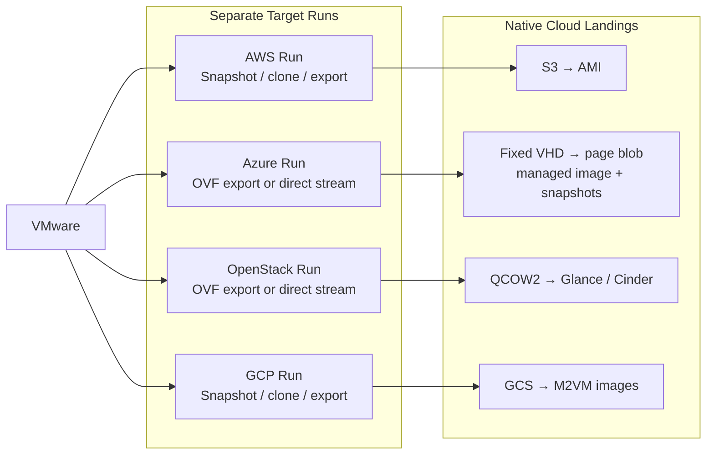

# Workflow

<!-- markdownlint-disable MD013 -->

Each standard AWS, Azure, OpenStack, or GCP migration is a separate run that
performs its own VMware snapshot, clone, OVF/OVA export, and manifest
generation. The target playbooks reuse the same task implementation for those
stages, then import the run's exported disks using the selected cloud's native
workflow and record the result in the migration catalog. The export manifest
is target-neutral and may include ordered `source_mac_addresses` from vSphere
for OpenStack launches that preserve network identity.

CentOS 7 guests with static IP addresses can first be staged with
`bin/stage-v2v.sh`, which installs a one-time boot script that switches the
guest to DHCP. This is a separate, optional step before an OpenStack run and
is not part of the diagram below.

Azure and OpenStack can alternatively use datastore-direct migration
(`playbooks/migrate-azure-vm-vddk.yml` and
`playbooks/migrate-openstack-vm-vddk.yml`). These runs skip the clone and OVF
export: they snapshot the running VM and stream the frozen disks from the
datastore. Both routes produce the same native artifacts for their target.
See [datastore-direct.md](datastore-direct.md).

Azure uses the managed image for the boot disk and managed snapshots for data
disks. Launch creates an OS disk and managed data disks from those artifacts.

The migration catalog records each completed target artifact and its provenance.
The launch playbooks select the newest completed migration for a VM unless an
artifact is supplied explicitly. Successful runs remove temporary VMware,
cloud-staging, and local artifacts. Failed Azure, OpenStack, and GCP runs
retain resumable artifacts; datastore-direct failures also retain the source
snapshot for resume or discard. Failed AWS imports retain the staged OVA in
S3 for a follow-up import. Retained artifacts are deleted when
`discard_failed_artifacts=true` is supplied.

See the target playbooks in [README.md](../README.md#flow) for command examples
and the platform-specific requirements.
