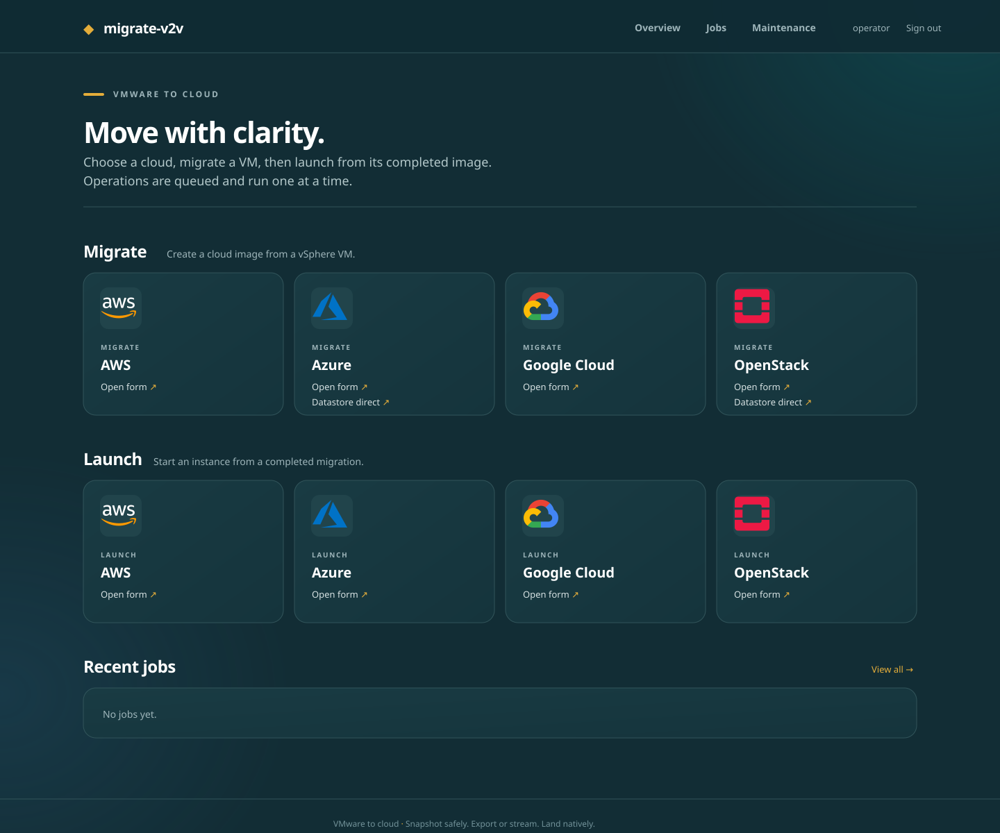

# Controller Web UI



The overview puts every destination one click away. Choose a cloud to migrate
a vSphere VM, then launch from its completed image. Azure and OpenStack also
offer datastore-direct migration. Recent jobs keep the controller's activity
in view. The SVG shows a new controller before its first job.

The site queues the repository's existing `bin/` migrate and launch wrappers.
A completed migration in the image catalog is required before launch. Each
controller uses its own vaults, and every local web account can use the
environments in those vaults.

Migrate and launch both begin with a vault project selector. Migration then
asks for the source vCenter and VM. Launch loads the selected project's
available subnets, security groups, key pairs, flavors, zones, machine
types, and networks using the same `bin/*-project-facts.py` tools as the
dialogs. Suggestions can be typed over when a known value is absent. AWS
security groups depend on the selected subnet; GCP machine types and
subnetworks depend on the selected zone and network. Use **Update choices**
after changing those fields. If a cloud lookup fails, the form offers
manual entry.

The form field set and wrapper names are read from the corresponding
`bin/*-dialog.sh` scripts when a page is requested. `web/forms.py` supplies
input labels, defaults, and validation. When changing a dialog, run `python3 -m
unittest discover -s web/tests -v` and review the web metadata. The test checks
hashes of all dialog scripts; after reconciling any changed wording, defaults,
and behavior, update `web/dialog-checksums.json`. If a dialog exports a new
variable without web metadata, the form refuses to load rather than silently
dropping it. The dialog script is authoritative if wording or behavior differs.

## Running the controller

The controller is a Python process, `python3 web/app.py serve`, that listens on
plain HTTP (`127.0.0.1:8080` by default). It needs HTTPS in front of it because
its login cookie is `Secure`. Two choices are independent of each other:

- **Where the app runs.** In a container, from the Compose stack in
  [docker.md](docker.md), which bundles every runtime dependency. Or directly on
  the Ansible control host, below.
- **Where Caddy runs.** In the Compose stack, or on the control host (as a
  script for testing or as a systemd service). See [caddy.md](caddy.md).

For a first-time host deployment,
[`examples/controller-v2v.sh`](../examples/controller-v2v.sh) prepares the
host Python/Ansible environment and web account, installs Caddy if missing,
and enables both host services.

### On the control host

The Python process can use the repository dependencies installed on the host.
From the repository root, set `VAULT_PASSWORD_FILE` to the existing readable
vault password file, then create a local account:

```sh
export VAULT_PASSWORD_FILE="$HOME/.dib-vault-pass"
python3 web/app.py user add operator
```

Start the web backend:

```sh
python3 web/app.py serve
```

Then put HTTPS in front of it with Caddy ([caddy.md](caddy.md)); for testing,
`local/run-caddy.sh` starts both. A service install uses the systemd units in
[examples/README.md](../examples/README.md#caddy-on-the-ansible-control-host).

## Accounts, jobs, and security

The site's local accounts use 3 to 32 character usernames and 12 to 16384
character passwords stored as salted scrypt hashes, signed HttpOnly sessions,
and CSRF tokens. Sign-in limits each account from one client IP to 10 attempts
and each client IP to 30 attempts in five minutes, with at most four password
hashes running at once. Manage accounts with `python3 web/app.py user add NAME`
(also resets a password), `user delete NAME`, and `user list`. In Docker, run
the same commands in the controller service (see [docker.md](docker.md#setup)).

Jobs are stored in `WEB_STATE_DIR/jobs.sqlite3` and processed one at a time.
`WEB_STATE_DIR` defaults to `/work/migrate-v2v/web-state`; it does not
follow `ARTIFACT_ROOT`, so set both when the artifact root lives elsewhere.
Job output is stored in mode `0600` log files there. A running job stopped
by a controller shutdown or restart is marked **interrupted** and is never
rerun automatically. Review its log and cloud state before submitting another
operation. A queued job can be cancelled from its job page before the worker
claims it. Running jobs cannot be cancelled in the UI because terminating a
migration may leave cloud resources before cleanup runs. The site does not
offer arbitrary shell arguments or a terminal.

The **Maintenance** page shows concise migration and launch catalog entries
grouped by cloud provider in a print-friendly view, with a separate option
to inspect both catalog files as raw JSON. It can also clear finished job
records and their output logs; queued, running, and failed or interrupted
migration jobs with pending recovery actions are retained. **Manage failed jobs**
reads retained run IDs from job output and queues resume actions for Azure, GCP,
and OpenStack migrations, or discard actions for Azure and OpenStack
datastore-direct runs.
The action is created as a new queued job, preserving the original job and its
log. Runs without an explicit resume or discard hint in the saved output are
shown without an action.

## Files selected in the forms

Files selected in the web forms (SSH public keys, a vCenter CA bundle,
OpenStack cloud-init data, or virtio-win driver files) must be placed under
`WEB_INPUT_DIR`, which defaults to `ARTIFACT_ROOT/web-inputs`
(`/work/migrate-v2v/web-inputs` in Compose). The site resolves symlinks and
rejects input paths outside that directory, including vault and web-state
files. Do not put secrets in the input directory. The virtio-win field accepts
an ISO file or an unpacked driver directory.

For an OpenStack datastore-direct migration with guest conversion enabled, the
host play installs Ubuntu's `virt-v2v`, `libguestfs-tools`, and Windows
`rhsrvany` packages if needed, then builds the fixed appliance under
`ARTIFACT_ROOT/libguestfs-appliance`. The container image has those packages
already and uses its baked appliance at `/tmp/libguestfs-appliance`. Windows
conversions download Fedora's stable virtio-win ISO to
`ARTIFACT_ROOT/web-inputs/virtio-win.iso` when missing; the form pre-fills that
path.
